# RadarLab

**An open-source FMCW TDM-MIMO radar simulator with a NumPy reference implementation, a browser twin in TypeScript, and validation against detection and estimation theory.**

[](https://github.com/EnesErdogans/radarlab/actions/workflows/ci.yml)
[](LICENSE)
[](python/pyproject.toml)
[](web/package.json)

**Live demo:** <https://eneserdogans.github.io/radarlab/> (runs in the browser, no installation)

Enes Erdoğan, Department of Electrical and Electronics Engineering, Abdullah Gül University, Kayseri, Türkiye

Türkçe özet: [README.tr.md](README.tr.md)

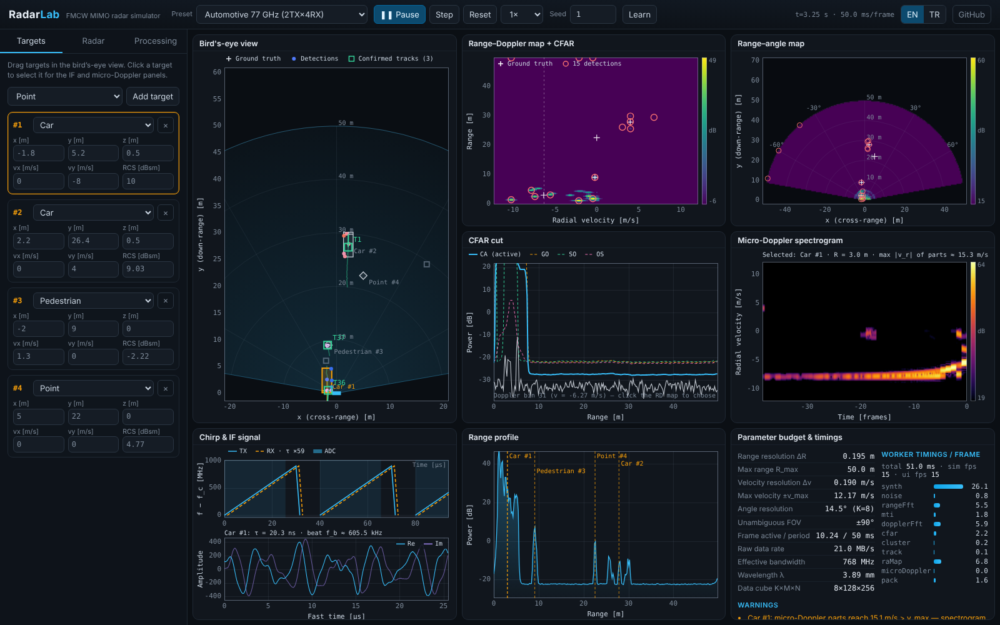

*Figure 1. The web application with the automotive 77 GHz preset: bird's-eye view with tracks, range–Doppler map with CFAR detections, range–angle map, CFAR cut, micro-Doppler spectrogram, chirp/IF signal, range profile and the parameter budget with per-stage worker timings.*

---

## Contents

- [Abstract](#abstract)
- [1 Introduction and motivation](#1-introduction-and-motivation)
- [2 System overview](#2-system-overview)
- [3 Signal model](#3-signal-model)
- [4 Target and impairment models](#4-target-and-impairment-models)
- [5 Signal processing chain](#5-signal-processing-chain)
- [6 Validation](#6-validation)
- [7 Interactive web application](#7-interactive-web-application)
- [8 Working with real hardware](#8-working-with-real-hardware)
- [9 Getting started](#9-getting-started)
- [10 Limitations and roadmap](#10-limitations-and-roadmap)
- [Citation](#citation) · [License](#license) · [Acknowledgements](#acknowledgements) · [References](#references)

---

## Abstract

RadarLab is an open-source framework for simulating and processing frequency-modulated continuous-wave (FMCW) radar with time-division-multiplexed MIMO (TDM-MIMO) arrays. It has two implementations. The Python implementation is the reference: it synthesises the exact beat signal, including residual video phase, intra-chirp motion and TDM timing, and it models hardware impairments such as range-correlated phase noise, Tx–Rx leakage, IQ imbalance, quantisation, ground multipath and FMCW interference. The TypeScript implementation runs the same chain in a Web Worker at interactive frame rates. Cross-language golden vectors check that the two are numerically equivalent for synthesis (complex and real IF, both amplitude modes), MTI, FFT processing, CA/GO/SO/OS-CFAR, clustering, peak, angle and elevation estimation and the range–angle map (Section 6.1 lists what is and is not covered). The processing chain contains windowed range and Doppler FFTs, MTI, CA/GO/SO/OS-CFAR with exact Gamma(K) thresholds for non-coherent integration over K virtual channels, FFT/MVDR/MUSIC direction finding, clustering, an EKF tracker and micro-Doppler analysis. Eight validation experiments compare the simulator with independent closed-form theory (false-alarm and detection probabilities, Cramér–Rao bounds, phase-noise spectra, two-ray nulls, interference geometry, micro-Doppler extent). Five further experiments are implementation consistency checks (IQ-image identity, blade-flash periodicity, TDM compensation, golden-file regeneration, and a closed loop through TI mmWave `.cfg` files and DCA1000 raw data). All 8 theory validations and all 5 consistency checks pass.

---

## 1 Introduction and motivation

FMCW radar with MIMO virtual arrays is the standard sensor architecture in automotive radar [1, 2], and the same hardware is used more and more for short-range drone detection. Simulation is used to develop processing algorithms, to generate training data and to teach the signal chain. For these uses the simulator must be statistically correct: a detector that is tuned on simulated noise must have the same false-alarm rate on real noise, and an estimator must reach the accuracy that theory predicts.

Several simulators and toolkits exist (Table 1). Most published validation is either a comparison with measurements of one scene [3] or an equivalence of downstream task results [4]. The survey by Magosi et al. notes that validation metrics for radar sensor models are not standardised [5]. We did not find an open simulator that reports systematic Monte-Carlo agreement with detection theory (Pfa, Pd for several CFAR types) and estimation bounds (CRLB for range, velocity and angle).

*Table 1. Related tools (summarised from the literature review in [`docs/literature/review.md`](docs/literature/review.md)).*

| Tool | Licence / access | Signal level | Impairments | Published validation | Browser / zero-install |
|---|---|---|---|---|---|
| RadarSimPy [6] | Repository states GPL-3.0; runtime module distributed as pre-built binaries | Raw baseband, arbitrary waveforms, TDM/CDM/FDM-MIMO | Tx phase noise, mutual interference | No validation paper found | No |
| MATLAB Radar Toolbox [7] | Proprietary | Detection level and I/Q level | Antenna patterns, receiver noise, multipath examples | Vendor examples | Desktop apps only |
| OpenRadar [8] | Apache-2.0 | Processing only (no simulator) | – | – | No |
| mmSim [9] | Open (Python) | IF signal, TI array layouts | Not stated | README states no validation against hardware | No |
| Schüßler et al. ray tracer [3] | Not public | Raw, large MIMO arrays | – | Yes, against MIMO measurements | No |
| SHENRON [4] | Open source | MIMO radar data from lidar and camera | – | Downstream algorithm equivalence | No |
| sar-sim [10] | Open (Python GUI) | FMCW SAR raw data | – | – | Desktop GUI |
| **RadarLab** | MIT, pure NumPy/SciPy and TypeScript | Raw TDM-MIMO beat signal | Phase noise (range-correlated), leakage, IQ imbalance, ADC, IF filters, Swerling, two-ray multipath, FMCW interference | Monte-Carlo agreement with closed-form theory (8 experiments) plus 5 consistency checks | Yes, GitHub Pages |

RadarLab does not try to compete on scene realism: it uses point and extended-scatterer models, not ray tracing. Its focus is the fidelity and verifiability of the signal chain.

**Contributions.**

1. An open (MIT) reference implementation of the exact FMCW TDM-MIMO beat model, with binding conventions for coordinates, signs, data layout and normalisation ([`docs/PROJECT_BRIEF.md`](docs/PROJECT_BRIEF.md)).
2. A validation matrix with reproducible scripts and a generated report ([`python/examples/out/validation_report.md`](python/examples/out/validation_report.md)). It keeps validations against independent closed-form theory (8 experiments) apart from implementation consistency checks (5 experiments).
3. A verified implementation of the known exact CFAR thresholds for non-coherent integration over K channels (Gamma(K) noise: CA in closed form, OS/GO/SO by quadrature), and a quantification of the error made by a common misuse: applying the single-channel formula to the K-channel sum (Section 5.3). The exact thresholds themselves are classical results [37, 38]; the contribution is the checked implementation and the practitioner warning.
4. A zero-install browser twin. Its numerical equivalence to the reference is checked in continuous integration by cross-language golden vectors for synthesis, MTI, FFT processing, all four CFAR types, clustering, peak/angle/elevation estimation and the range–angle map (Section 6.1).
5. A closed real-data path: TI mmWave `.cfg` → simulation → int16 DCA1000 `.bin` → reader → the same processing chain that is used for real captures.
6. One framework for automotive (77 GHz) and counter-UAS (24 GHz, micro-Doppler) scenarios, including a line-blade rotor model with blade flashes and a two-segment flapping-wing bird model.

---

## 2 System overview

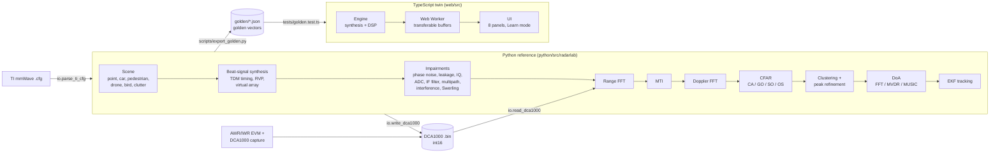

*Figure 2. Architecture. The Python package is the reference for research and real data. It generates golden vectors that the TypeScript test suite must reproduce. Simulated and real DCA1000 captures go through the same reader and processing chain.*

The two implementations follow one set of binding conventions:

- Radar at the origin, boresight +y, x to the right, z up. Azimuth θ = atan2(x, y), positive to the right; elevation φ = atan2(z, hypot(x, y)).
- Radial velocity is positive for receding targets.
- Data cube layout (K virtual channels, M chirps, N samples), complex, C order. The range–Doppler cube is (K, N range bins, M Doppler bins), with the Doppler axis fftshifted so that bin M/2 is 0 m/s.
- Forward FFT kernel exp(−j2πkn/N). Window coherent gain is normalised (division by Σw).
- Noise is complex white Gaussian with unit variance per complex sample, so amplitudes are directly per-sample SNRs.

Why two implementations? Python with NumPy/SciPy is the natural tool for research, Monte-Carlo studies and real data. The browser needs interactive frame rates without a heavy runtime; a Pyodide build was not practical for this purpose. The cost of two code bases is controlled by golden vectors (Section 6.1), which are also a reproducibility result in their own right.

---

## 3 Signal model

### 3.1 Waveform and timing

Each TX transmits linear chirps with start frequency $f_c$ and slope $S$. In TDM-MIMO, the $n_{Tx}$ transmitters take turns, so one TX repeats every $T_e = n_{Tx} T_c$, where $T_c$ is the chirp period (ramp plus idle). Chirp $m$ of transmitter $t$ starts at

$$
t_{m,t} = m\,T_e + t\,T_c ,
$$

and ADC sample $n$ is taken at $t_{m,t} + t_{\mathrm{adc}} + n/f_s$, where $t_{\mathrm{adc}}$ is the ADC start time. The fast time inside a chirp is $t_f = t_{\mathrm{adc}} + n/f_s$.

### 3.2 Beat signal of one scatterer

The range is linear inside a chirp, $R(t) = R_m + v_{r,m}(t - t_{m,t})$, where $R_m$ and $v_{r,m}$ are the instantaneous range and radial velocity of the scatterer at $t_{m,t}$. With the round-trip delay $\tau = 2R(t_{m,t}+t_f)/c$, the complex beat signal of virtual channel $k$ is

$$
x[k,m,n] = A \exp\Big( j\big[\, 2\pi\big( f_c \tau + S \tau t_f - \tfrac{1}{2} S \tau^2 \big) - 2\pi\, p_k \sin\theta\cos\varphi - 2\pi\, z_k \sin\varphi + \phi_0 \big] \Big).
$$

- The term $f_c\tau$ gives the Doppler phase progression from chirp to chirp.
- The term $S\tau t_f$ gives the beat frequency $f_b = 2SR/c$. Because $\tau$ is evaluated at every sample, the intra-chirp range–Doppler coupling and the range migration over the frame are contained in the model and are not removed.
- The term $-\tfrac12 S\tau^2$ is the residual video phase (RVP).
- The spatial term is **negative**. An element at $+x$ is closer to a target at $\theta > 0$, so its delay is shorter. This is the physically correct far-field sign under the mixing convention above (brief revision 1, convention version 2). All steering vectors use the same sign, so an estimated $\theta > 0$ means a target to the right.

The virtual array is formed by $p_k = p^{Tx}_t + p^{Rx}_r$ and $z_k = z^{Tx}_t + z^{Rx}_r$ (in wavelengths), with $k = t\,n_{Rx} + r$.

### 3.3 Amplitude

Two amplitude modes are available. In the `snr` mode, $A = \sqrt{\sigma}\,(R_{\mathrm{ref}}/R)^2\, 10^{\mathrm{SNR_{ref}}/20}$, where $\mathrm{SNR_{ref}}$ is the per-sample SNR of a 1 m² target at $R_{\mathrm{ref}}$. In the `physical` mode the radar equation is used,

$$
P_r = \frac{P_t G_t G_r \lambda^2 \sigma}{(4\pi)^3 R^4 L}, \qquad P_n = k T_0 F f_s, \qquad A = \sqrt{P_r/P_n}.
$$

Real-IQ mode returns the real part of the complex cube, noise included.

### 3.4 Derived quantities

With $\lambda = c/f_c$ and $B_{\mathrm{eff}} = S N / f_s$:

$$
\Delta R = \frac{c}{2B_{\mathrm{eff}}},\qquad
R_{\max} = \frac{f_s c}{2S}\ \text{(complex IF; half for real IF)},\qquad
\Delta v = \frac{\lambda}{2 M T_e},\qquad
v_{\max} = \frac{\lambda}{4 T_e}.
$$

The angle resolution in Table 2 is the boresight Rayleigh value $\Delta\theta = \arcsin\!\big(1/(N_{\mathrm{ULA}}\, d)\big)$ for a uniform linear array of $N_{\mathrm{ULA}}$ elements with spacing $d = \lambda/2$ (in wavelengths). This is the formula of the web parameter budget (`derive()` in [`web/src/config/radar.ts`](web/src/config/radar.ts)), so the table shows the same values: 14.5° for 8 elements and 30.0° for 4 elements. The small-angle form $1/(N_{\mathrm{ULA}} d)$ rad gives 14.3° and 28.6°.

*Table 2. Presets. Python values are those stored in [`golden/presets.json`](golden/presets.json); web values follow from the same formulas applied to the web presets in [`web/src/config/radar.ts`](web/src/config/radar.ts).*

| Preset | $f_c$ (GHz) | Array | $B_{\mathrm{eff}}$ (MHz) | ΔR (m) | $R_{\max}$ (m) | Δv (m/s) | $v_{\max}$ (m/s) | ULA elements | Δθ (°) |
|---|---|---|---|---|---|---|---|---|---|
| Python `automotive_77ghz` | 77 | 2 TX × 4 RX | 384 | 0.390 | 99.9 | 0.238 | 15.21 | 8 | 14.5 |
| Python `awr1843_like` | 77 | 3 TX × 4 RX (one TX elevated) | 768 | 0.195 | 50.0 | 0.253 | 8.11 | 8 (azimuth) | 14.5 |
| Python `drone_24ghz` | 24 | 2 TX × 4 RX | 150 | 0.999 | 511.6 | 0.407 | 26.02 | 8 | 14.5 |
| Python `micro_doppler_24ghz` | 24 | 1 TX × 4 RX | 250 | 0.600 | 38.4 | 1.220 | 156.14 | 4 | 30.0 |
| Web automotive | 77 | 2 TX × 4 RX | 768 | 0.195 | 50.0 | 0.190 | 12.17 | 8 | 14.5 |
| Web drone surveillance | 24 | 1 TX × 4 RX | 150 | 0.999 | 511.6 | 0.222 | 28.39 | 4 | 30.0 |
| Web micro-Doppler fast-chirp | 24 | 1 TX × 4 RX | 250 | 0.600 | 76.7 | 1.220 | 156.14 | 4 | 30.0 |

Note that $v_{\max}$ is reduced by $n_{Tx}$ in TDM-MIMO. The `awr1843_like` preset (3 TX, $T_c$ = 40 µs) therefore has $v_{\max}$ = 8.11 m/s, which is easily exceeded by road targets. Section 5.5 describes the compensation of the motion-induced phase between TX slots.

---

## 4 Target and impairment models

All targets are sets of point scatterers whose positions and *analytic* velocities are evaluated at arbitrary times, so the beat model of Section 3 is applied to every scatterer without approximation of the motion within a chirp.

### 4.1 Targets

| Model | Description (Python reference, `radarlab.scene`) | Notes and approximations |
|---|---|---|
| `PointTarget` | One scatterer, constant-acceleration trajectory | Can be created from polar coordinates |
| `Car` | Bumpers, four corners and roof as dominant scatterers (fractions of the total RCS); optional rolling wheel-rim points | Wheel micro-Doppler between 0 and 2\|v\| |
| `Pedestrian` | Head, torso, elbows, hands, knees, feet; gait period $T = 1.346/\sqrt{v/H_t}$ (Boulic relation [11], as used in [12]); torso bobs at twice the gait frequency; arms and legs swing as pendulums in opposite phase | Simplified kinematics; the full Boulic model is on the roadmap |
| `Drone` | N rotors with $N_b$ blades. Default `blade_model='line'`: each blade is one line scatterer weighted by $\mathrm{sinc}(\Phi_k)$, $\Phi_k = (2\pi\ell/\lambda)\,\hat u_{\mathrm{blade}}\cdot\hat u_{\mathrm{LOS}}$ (Martin and Mulgrew closed form [13, 12]). Option `'points'` discretises the blade as a reference | Blade flash rate $N_b f_{\mathrm{rot}}$ for even $N_b$ and $2N_b f_{\mathrm{rot}}$ for odd $N_b$; maximum micro-Doppler $2\Omega L\cos\beta/\lambda$; optional RPM jitter per rotor |
| `Bird` | Body plus two wings with two segments each (shoulder and elbow angles driven sinusoidally); optional flap/glide intermittency as reported by Rahman and Robertson [14] | Scatterers at segment midpoints and wing tip |
| `ClutterField`, `static_clutter` | Many static scatterers, uniform in area over an annular sector, exponential RCS, random phase | Not a distributed-clutter (σ⁰) model |

The web engine uses the same point and car models, a pedestrian with arms, legs and torso bob, a drone with N rotors × 2 blades × 2 points (a point-blade model, not the line-blade model), a flapping bird, and cached static clutter.

### 4.2 Impairments (Python reference, `radarlab.impairments` and `radarlab.signal`)

| Impairment | Model | Notes and approximations |
|---|---|---|
| RCS fluctuation | Swerling 1–4 [15]. SW1/SW3: one complex gain per scatterer per frame, shared by all channels and chirps. SW2/SW4: per chirp | The per-frame-per-channel decorrelation recommended in the fidelity requirements for SW2/SW4 is not implemented |
| LO phase noise | Two-sided PSD $L(f) = L_0/(1+(f/f_{bw})^2) + L_{\mathrm{floor}}$, synthesised by frequency-domain shaping of white noise. One realisation per frame is shared by all TX, RX, scatterers and the leakage path; each path receives $\varphi(t) - \varphi(t-\tau)$ (range correlation [16, 17]) | Defaults $L_0$ = −87 dBc/Hz, $f_{bw}$ = 450 kHz, floor −140 dBc/Hz |
| Tx→Rx leakage | Static near-DC path (default 0.05 m), synthesised inside the frame so that it shares the phase-noise realisation [18] | Leakage power is a free parameter without a primary source |
| IF filtering | Causal Butterworth high-pass and low-pass along fast time (zero initial state, so the start-of-chirp transient appears) | The TI-specific filter (two first-order HPF sections at the TI corner frequencies, 4th-order LPF) is on the roadmap |
| ADC | Mid-tread uniform quantiser with clipping per I/Q rail; full scale set by the thermal-noise rms in LSB, an explicit value, or 4× the rail rms | Default 12 bits [19] |
| IQ imbalance | $y = \mu x + \nu x^*$ with $\mu = (1+g e^{-j\delta})/2$, $\nu = (1-g e^{j\delta})/2$; image rejection ratio $\lvert\mu\rvert^2/\lvert\nu\rvert^2$ [20] | – |
| Two-ray multipath | Flat ground: direct path, two mixed paths (amplitude 2Γ) and the image path (Γ²) [21] | The mixed path is an equivalent scatterer on the direct line of sight, so its elevation is approximate. Null positions agree with the closed form within 0.07 % when λ is taken at the ADC-window centre (V5) |
| FMCW interference | A second FMCW radar received one way; IF content kept where the instantaneous difference frequency lies inside the IF bandwidth [22] | Ideal low-pass mask on the instantaneous difference frequency |
| Real IQ | Real part of the complex cube; the range FFT keeps bins 0…N/2−1 | – |

The web engine implements thermal noise, static clutter, MTI and real-IQ mode. The other impairments are currently in the Python reference only.

---

## 5 Signal processing chain

### 5.1 Windows and FFTs

Range and Doppler FFTs use a periodic Hann window by default (Hamming, Blackman and rectangular are available) with coherent-gain normalisation. The Doppler axis is fftshifted. MTI is slow-time mean removal (a two-pulse canceller is also available in Python). The square-law detection map is the non-coherent sum over virtual channels,

$$
P[r,d] = \sum_{k=1}^{K} \big|X[k,r,d]\big|^2 .
$$

### 5.2 CFAR

Two-dimensional CFAR [23] runs on $P[r,d]$ with guard and training cells in range and Doppler. The Doppler axis is circular; at range edges the available cells are used and the threshold factor is recomputed for the actual number of training cells. Four detectors are implemented:

- **CA-CFAR**: threshold $\alpha$ times the mean of the training cells.
- **GO-/SO-CFAR**: the greater or smaller of the two half-window means [24]. Cells are split by the sign of the range offset (cells with zero range offset by the sign of the Doppler offset). If one half has fewer than a quarter of the training cells, CA is used instead.
- **OS-CFAR**: the $k$-th smallest training cell, $k = \mathrm{round}(0.75\,N)$ [25].

All closed forms assume i.i.d. training cells. This holds for a rectangular window; a Hann window makes adjacent bins correlated (Section 6.2, V1c).

### 5.3 Exact threshold for non-coherent integration over K channels

With unit-variance complex noise, each cell of $P$ is Gamma(K, 1) distributed under $H_0$, not exponential. The single-channel CA formula $\alpha = N(P_{fa}^{-1/N} - 1)$ is exact only for $K = 1$. For the CA detector, the ratio of the cell under test to the sum of itself and the training cells is Beta(K, NK) distributed, which gives the exact factor

$$
\alpha = \frac{N u}{1-u}, \qquad I_u(K,\, NK) = 1 - P_{fa},
$$

where $I_u(a,b)$ is the regularised incomplete beta function, so $u$ = `scipy.special.betaincinv(K, N*K, 1 - Pfa)`. For OS, GO and SO, the Python reference solves the exact Gamma order-statistic and half-sum integrals by adaptive quadrature and bisection. `process_frame` uses these exact factors by default, with $K$ equal to the number of summed channels.

**Size of the error.** If the single-channel factor is applied to the K-channel sum, the threshold is too high by the ratio of the two factors. From the table in [`golden/cfar_alpha.json`](golden/cfar_alpha.json) at design $P_{fa} = 10^{-4}$ (CA-CFAR):

| K | N = 16 | N = 24 | N = 32 |
|---|---|---|---|
| 4 | 4.5 dB | 4.2 dB | 4.1 dB |
| 8 | 6.1 dB | 5.7 dB | 5.6 dB |

So for K = 4–8 virtual channels and N = 16–32 training cells, the single-channel formula sets the threshold 4.1–6.1 dB too high. The detector then works at a much lower false-alarm rate than designed (about 5·10⁻¹³ instead of 10⁻⁴ in the reviewer's calculation) and loses a comparable amount of detection SNR (3.9–7.4 dB for Pd = 0.5–0.9).

**What is new and what is not.** The exact thresholds are not a new theory. Under non-coherent integration of M pulses or K channels the noise is Gamma distributed, and CFAR analyses for this case are classical; see, for example, Shor and Levanon for CA- and OS-CFAR with pulse integration [37] and Ritcey for the greatest-of (MX-MLD) detector with non-coherent integration [38]. What RadarLab adds is a verified implementation of these thresholds for all four detector types, and a number for the cost of a common pitfall: applying the single-channel formula after summing |X_k|² over the virtual channels.

**Monte-Carlo coverage.** V1 checks the empirical false-alarm rate for K = 1, 4 and 8 and all four detectors with N = 54 training cells in the interior and 29–47 cells at the range edges (Section 6.2). The N = 16–32 rows of the table above come from the exact formula. They are not separately simulated in the repository, but an independent Monte-Carlo in review round 1 (2·10⁶ trials per case, K ∈ {1, 4, 8}, N ∈ {16, 32}, all four detectors) agreed with all of them (|z| < 2).

### 5.4 Clustering and peak refinement

Detections are grouped by connected components (with circular Doppler), by DBSCAN, or by local maxima. The peak of each cluster is refined with a three-point parabola on log power in range and Doppler.

### 5.5 Direction of arrival

Before angle estimation, the TX-$t$ channels are multiplied by $\exp(-j 2\pi (2v/\lambda)\, t\, T_c)$, using the velocity estimated from the fractional Doppler bin. This removes the motion-induced phase between TX slots [26].

- **FFT DoA.** The azimuth ULA is built from the z = 0 virtual channels with unique x positions on a grid of the smallest spacing $d$ (gaps are zero-filled). The angle spectrum uses the $+j$ kernel, $A[a] = \sum_k x_k \exp(+j2\pi k a/N_a)$, with zero padding to $N_a$ = 64, so that bin $a$ maps to $\sin\theta = (a - N_a/2)/(N_a d)$ and $\theta > 0$ falls in a bin above $N_a/2$.
- **MVDR** [27] and **MUSIC** [28] (Python) use the same negative-sign steering vectors $a_k = \exp(-j2\pi(x_k\sin\theta\cos\varphi + z_k\sin\varphi))$, with optional forward–backward averaging and diagonal loading. A Bartlett spectrum is also available.
- **Elevation** is estimated from virtual-channel pairs with the same x and different z: $\varphi = \arcsin\!\big(-\arg(\sum x_{\mathrm{low}}^{*} x_{\mathrm{high}})/(2\pi\Delta z)\big)$.
- **Point cloud.** The azimuth FFT measures the direction cosine $u_x = \sin\theta\cos\varphi$, not $\sin\theta$. The Python point cloud therefore uses $x = R u_x$, $z = R\sin\varphi$, $y = R\sqrt{1 - u_x^2 - \sin^2\varphi}$ and reports $\theta = \operatorname{atan2}(x, y)$. Without an elevation estimate (planar arrays, and the web engine) $\varphi$ is taken as 0, so a target at elevation $\varphi$ is reported at $\arcsin(\sin\theta\cos\varphi)$. This is a bias of 0.29° at θ = −18°, φ = 10° (golden file `awr1843_elevated`), and it grows with φ.
- A **range–angle map** is computed for display.

### 5.6 Tracking

The tracker is an extended Kalman filter with a constant-velocity, white-noise-acceleration model and state $[p_x, p_y, v_x, v_y]$ [29]. The measurement is $z = [R, \theta, v_r]$ with $v_r = (p_x v_x + p_y v_y)/R$; angles are wrapped in the innovation. Association is global nearest neighbour (Hungarian algorithm) on the Mahalanobis distance with a χ² gate. Tracks are confirmed after M of N hits (default 3 of 5) and deleted after a number of consecutive misses (default 3). The Python tracker has no extended-target merging, so a car that produces several detections can start several tracks (the quick-start example in Section 9.1 gives three confirmed tracks for one `Car`). The web version uses a different design: a χ² gate of 9.21 on the position innovation, a wrapped Doppler innovation, merging of extended-target measurements with a DBSCAN-style rule, and suppression of new tracks near existing ones.

### 5.7 Micro-Doppler

The micro-Doppler spectrogram is a short-time Fourier transform over slow time in a single range bin. (With a Hann range window, a coherent sum over adjacent range bins partly cancels, so one bin is used.) The web application keeps a rolling spectrogram for the selected target.

---

## 6 Validation

RadarLab separates three kinds of evidence. (T1) **Validation against independent closed-form theory**: the output of the simulator and the processing chain is compared with a result derived independently of the code. (C) **Implementation consistency checks**: the reference comes from the same model or code, so these checks find regressions and wiring errors but cannot find a shared modelling error. (T2) **Cross-implementation agreement** between Python and TypeScript (golden vectors). A further tier, comparison with real captures, is planned (Section 10). All numbers in this section are in [`python/examples/out/validation_report.md`](python/examples/out/validation_report.md), which `python/examples/validation_report.py` generates in full (paper-grade) mode. The rest come from the test suites, as stated.

### 6.1 Cross-implementation golden vectors

`python/scripts/export_golden.py` writes the JSON files in [`golden/`](golden/). The current files are golden set 2 (`"goldenSet": 2`, `conventionVersion: 2`). [`golden/README.md`](golden/README.md) lists each file, its stored inputs and its tolerances. Every input a consumer needs is stored in the file, so no random number generator is needed to check it.

- **Scenario files** (`tiny_cube`, `automotive_single`, `automotive_multi`, `automotive_velocity_alias`, `awr1843_elevated`, `tiny_mti`, `tiny_real_iq`, `tiny_physical`). They contain the configuration, scatterers, raw cubes (full cubes for tiny configurations, spot samples otherwise), range–Doppler maps and expected peaks, plus the truth values and tolerances. Together they cover MTI, real-IF sampling and the `physical` amplitude mode. `tiny_cube` also stores the range–angle map for a rectangular and a Hann angle window, and `awr1843_elevated` stores the elevation estimate and the point-cloud azimuth and x/y/z.
- **Detection files.** `cfar_alpha` is the α table for K ∈ {1, 4, 8}. `cfar_maps` holds two fixed 20×16 power maps (K = 1 and K = 8) with CA/GO/SO/OS thresholds, per-cell α and detection masks, including the range edges, the GO/SO lead/lag split and the CA fallback. `clustering` is a stored CFAR mask with the expected 8-connected clusters, including a cluster that wraps across the Doppler seam.
- **`tracker`**: a stored detection sequence and the Python EKF states, covariances and track statuses frame by frame. The interactive web tracker is a different design (Section 5.6). The web suite checks a TypeScript port of the Python tracker (`ReferenceTracker`) against this file; the UI tracker itself is not golden-checked.
- **`presets`**: derived quantities, virtual arrays and windows.

The web test `tests/golden.test.ts` reads every file:

| Quantity | Tolerance |
|---|---|
| Derived parameters, preset windows | 1e-12 |
| Raw cube, exact synthesis (complex and real IF, `snr` and `physical` amplitude) | 1e-9 of max |
| Raw cube, phasor-recurrence synthesis | 1e-7 of max |
| Range–Doppler map in dB (cells within 90 dB of the peak), with and without MTI | 1e-6 dB |
| Peaks: integer bins | exact |
| Peaks: fractional bins, range, velocity | 1e-6 |
| Peaks: angle (with and without TDM compensation), elevation, point-cloud azimuth and x/y/z | 1e-4° / 1e-6 |
| Range–angle map, rect and Hann angle window | 1e-9 of max |
| CFAR α table, CA/GO/SO/OS, K = 1, 4, 8 | rel 1e-7 |
| CFAR maps: thresholds, α, masks, K = 1 and 8, incl. range edges and GO/SO fallback | rel 1e-9, 0 mask differences |
| Clustering: peaks, sizes, member cells | exact (compared as sets) |
| Reference tracker: state, covariance, status, hits | 1e-9 |

All checks pass. The web suite reports a worst relative threshold difference of 7e-13 on `cfar_maps` and 0 mask differences ([`web/STATUS.md`](web/STATUS.md)). Before golden set 2, the review found that the web GO/SO/OS thresholds at K = 8 were 2.6–3.3 times too high, because those types used the K = 1 formulas. Set 2 found that divergence, and the web engine now uses the exact Gamma(K) α for all four types.

The peak tolerances against truth come from the noiseless maths and are not blanket half-bin values. The fractional-bin interpolation is allowed 0.03 bin, and the FFT angle is allowed 0.05°. On top of this, each file adds the largest known deterministic offset: the range–Doppler coupling, the Doppler scaling with the ADC-window centre frequency (`fc` is the chirp *start* frequency), and the cosφ projection of a 1-D azimuth FFT. The files also store the "observable" truth with these offsets included. Against that truth, only the interpolation tolerance is allowed.

On the Python side (V10), the stored files are identical to a fresh export: the largest relative deviation is 0 for all 13 files.

The following are **not covered** by golden vectors: noise and all random impairments, the Python-only impairments, micro-Doppler targets, MVDR/MUSIC, DBSCAN, the micro-Doppler STFT, the web OS-CFAR prefilter (the web suite tests it separately), the interactive web tracker, and zero-padded or non-Hann range/Doppler FFTs.

### 6.2 Validation matrix

*Table 3a. Validation against independent closed-form theory (full mode). All 8 pass.*

| ID | Validation | Criterion | Measured result | Result |
|---|---|---|---|---|
| V1 | Noise + CFAR false-alarm rate, rect windows, fixed/CA/OS/GO/SO, K = 1, 4 and 8, design Pfa = 1e-4 | \|log10(Pfa_sim/Pfa)\| < 0.1 | Largest \|log10 ratio\| 0.028 (GO, K = 4); 3,006,464 cells per case | PASS |
| V1c | CFAR Pfa with Hann windows (documented effect) | adjacent-cell correlation −2/3 ± 0.05 | Correlation −0.6725; Pfa ratio 1.61 (CA) and 1.57 (OS) at design 1e-3, vs 1.01 and 1.03 with rect | PASS |
| V2 | Pd vs SNR, Swerling 0/1/3, K = 1 and 8, fixed threshold | theory inside the 99.9 % CI at every point (95 % CI reported) | 29 of 30 points inside the 95 % CI and 30 of 30 inside the 99.9 % CI; 3000 trials per point | PASS |
| V3 | RMSE vs CRLB for range, velocity, angle (unwindowed ML estimator) | efficiency CRLB/MSE ≥ 0.9 above threshold | Efficiency 0.956–1.041 for per-sample SNR from −12 dB to +6 dB | PASS |
| V4 | Phase noise, range-correlated residual (τ = 0.68 µs) | variance within ±2 %; PSD within ±0.5 dB at fτ = ½ | Variance error −0.95 %; PSD deviation −0.025 dB | PASS |
| V5 | Two-ray ground multipath | null positions within 0.1 % (λ at the ADC-window centre); amplitude ±1 dB where 4sin² ≥ 1 | Five nulls (15.4–77.3 m), largest relative error 0.064 %; amplitude max deviation 0.59 dB, rms 0.11 dB | PASS |
| V7 | FMCW mutual interference | burst length ±1 sample; ghost ±1 range bin | Burst 6 samples in each of 4 chirps (theory 6); ghost at 9.076 m vs 8.994 m (bin 0.293 m) | PASS |
| V8 | Micro-Doppler: rotor extent, bird wing-beat | f_mD,max ±1 bin; wing-beat ±2 % | f_mD,max 12.07 kHz (theory) vs ±12.11 kHz (simulated), bin 390.6 Hz; wing-beat 5.003 Hz vs 5 Hz (+0.067 %) | PASS |

*Table 3b. Implementation consistency checks (full mode). All 5 pass. In each of them, the reference is produced by the same model or code.*

| ID | Check | Why it is a consistency check | Measured result | Result |
|---|---|---|---|---|
| V6 | IQ imbalance image = −IMRR ± 0.5 dB | The model is y = μx + νx*, so image/signal = \|ν\|²/\|μ\|² holds by algebra | IMRR 28.93 dB, image −28.93 dBc (error 1e-11 dB) | PASS |
| V8f | Blade-flash rate ±1 % (N_b = 2, 3) | The rotor model is strictly periodic by construction | Relative error −1e-16 and −4e-6 | PASS |
| V9 | TDM-MIMO Doppler phase compensation (v = 0.8 v_max), bias < 0.1 angle bin | Synthesiser and compensator use the same t·Tc timing. An independent bistatic synthesiser in review round 1 confirmed the physics (θ = 20.05° for a +20° target) | Bias −2.44 bins without and below 0.001 bins with compensation | PASS |
| V10 | Golden vectors, Python side: stored = regenerated | Same code on both sides | Largest relative deviation 0 (13 files) | PASS |
| V11 | DCA1000 closed loop (.cfg → sim → int16 .bin → read → process) | Writer and reader share one byte-layout assumption; no real capture is used | Exact round trip; same 2 strong detections; range error 0.0067 m with ΔR = 0.195 m | PASS |

**False alarms (V1, V1c).** With rectangular windows, the empirical false-alarm rates of all four CFAR types agree with the design value for K = 1, 4 and 8 (the K > 1 cases use the exact Gamma(K) factors of Section 5.3). With a Hann window, adjacent noise bins have a correlation of −2/3, the i.i.d. assumption breaks, and the CA false-alarm rate rises by a factor of about 1.6. Analytic CFAR tests therefore use rectangular windows.

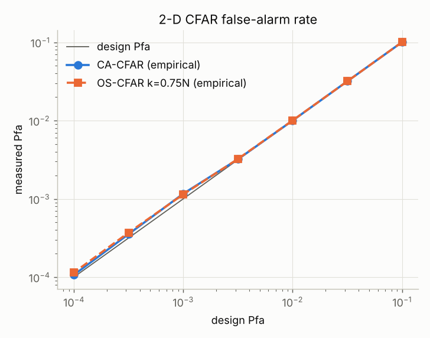

*Figure 3. Empirical vs design false-alarm probability for CA- and OS-CFAR (`python/examples/cfar_pfa.py`).*

**Detection (V2).** The synthesiser and detector are compared with closed-form Pd for Swerling 0 (generalised Marcum Q), Swerling 1 with the fluctuation shared by all K channels, and Swerling 3 [30, 15]. The pass criterion is fixed in advance: theory must lie inside the 99.9 % Wilson interval at every one of the 30 points (a Bonferroni-style bound for 30 comparisons); the 95 % intervals are reported as well. The one point outside the 95 % interval (K = 8, SW3, 0 dB: 0.142 simulated vs 0.158 theory) is inside the 99.9 % interval. V2 uses a fixed threshold, not a CFAR. The CA-CFAR Pd for Swerling 1, $(1 + \alpha/(N(1+\chi)))^{-N}$, is checked separately by a Monte-Carlo unit test (`test_pd_ca_cfar_swerling1_monte_carlo`).

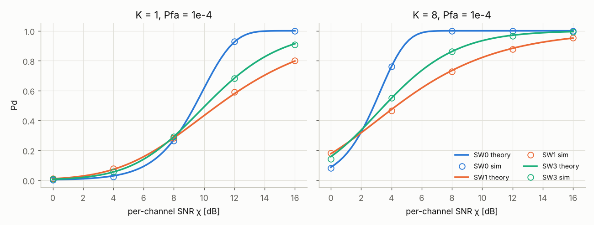

*Figure 4. Probability of detection vs per-sample SNR, simulation vs theory (V2).*

**Estimation (V3).** Range, velocity and angle are estimated with an unwindowed maximum-likelihood tone estimator and compared with the Cramér–Rao bound for a single complex exponential with unknown amplitude and phase [31, 32]. Above the threshold region the estimator is efficient (efficiency 0.96–1.04). At −20 dB per-sample SNR and below, the RMSE departs strongly from the bound, which is the expected threshold effect. Note that V3 validates the *simulated data* with an efficient estimator; it does not show that the processing chain is efficient. The chain uses Hann windows and parabolic interpolation on log power, which is biased (up to about 0.02 bin in the noiseless golden cases) and loses SNR to the window. The angle bound assumes that angle and velocity are decoupled; for TDM-MIMO with an unknown velocity the TX-slot Doppler phase couples them, so the bound is optimistic in that case.

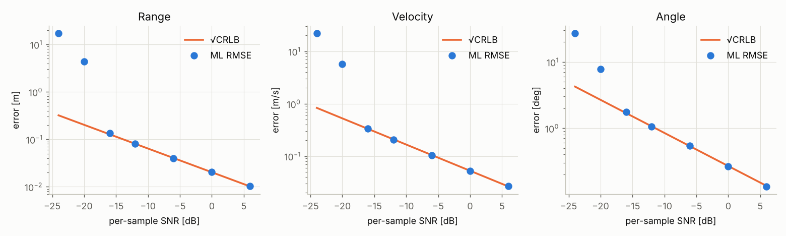

*Figure 5. RMSE vs √CRLB for range, velocity and angle (V3).*

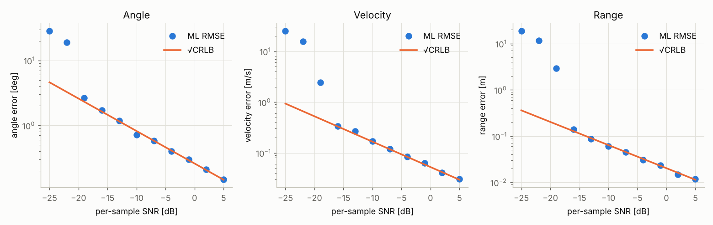

*Figure 6. The same comparison from the stand-alone example `python/examples/rmse_crlb.py`.*

**Phase noise and multipath (V4, V5).** The variance of the residual $\varphi(t) - \varphi(t-\tau)$ and its PSD follow $L(f)\cdot 4\sin^2(\pi f \tau)$ [17]. The two-ray nulls match the closed form within 0.064 % once λ is taken at the centre of the ADC window, $\lambda_c = c/(f_c + S\,t_{\mathrm{mid}})$, which is 0.27 % above $f_c$ for this configuration. With λ at the chirp start frequency $f_c$ the predicted nulls would be 0.27 % too close. Away from the nulls (where $4\sin^2 \ge 1$) the simulated amplitude follows the $4\sin^2$ law within 0.59 dB (rms 0.11 dB).

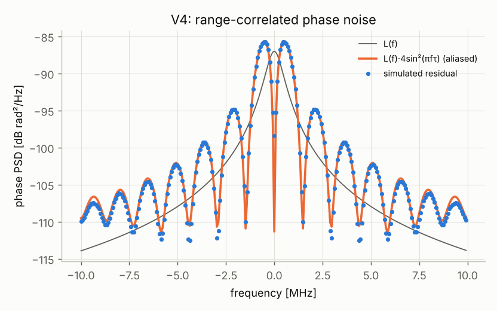

*Figure 7. Range-correlated phase-noise residual, simulation vs theory (V4).*

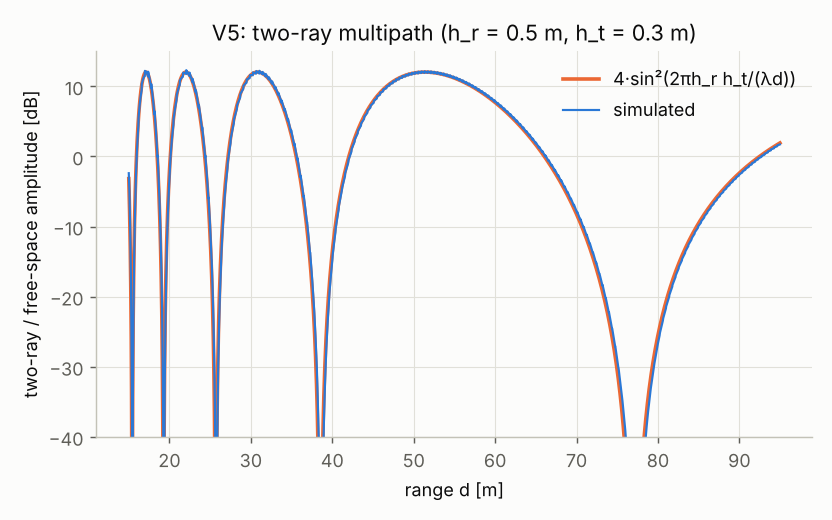

*Figure 8. Two-ray ground multipath: received power vs range and null positions (V5).*

**Micro-Doppler (V8, V8f).** The maximum micro-Doppler frequency of a rotor and the bird wing-beat frequency agree with the closed-form kinematics within the stated tolerances (V8). The blade-flash rate for $N_b$ = 2 and 3 (V8f) is only a consistency check, because the rotor model is periodic by construction.

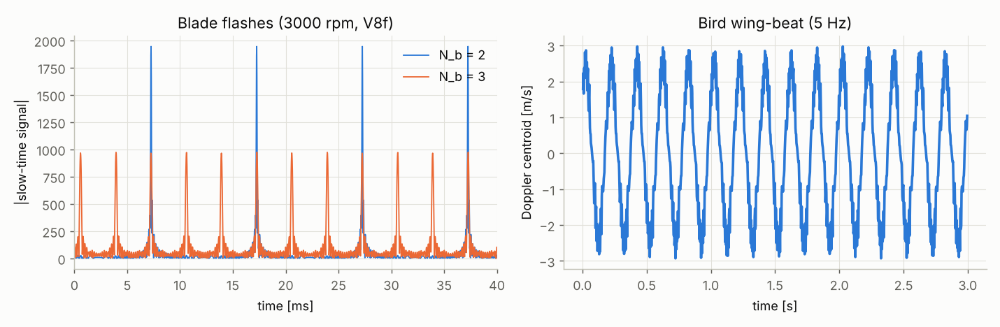

*Figure 9. Blade flashes (V8f) and bird wing-beat (V8).*

### 6.3 Example figures

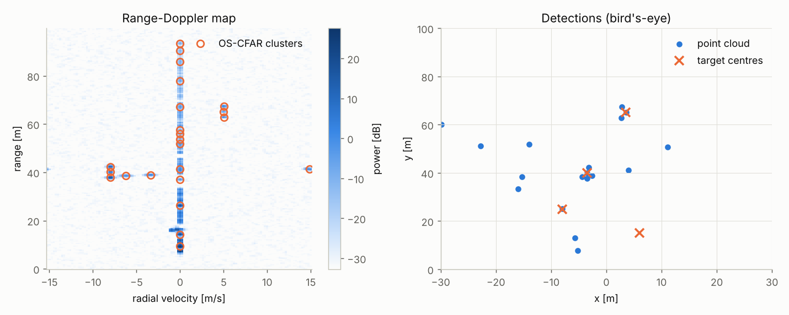

*Figure 10. Automotive scene: range–Doppler map with OS-CFAR clusters and a bird's-eye point cloud (`python/examples/rd_map_automotive.py`).*

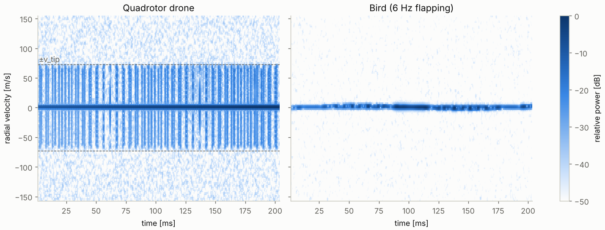

*Figure 11. Micro-Doppler spectrograms of a quadrotor and a bird at 24 GHz (`python/examples/micro_doppler.py`).*

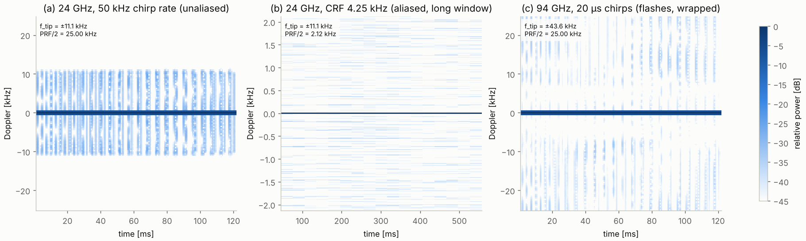

*Figure 12. Three sampling regimes for the same rotor: unaliased, K-band with a 4.25 kHz chirp repetition frequency (aliased), and a 20 µs fast chirp, following the regimes reported by Rahman and Robertson [14] (`python/examples/micro_doppler_regimes.py`).*

### 6.4 Test suites

| Suite | Command | Tests |
|---|---|---|
| Python, default | `pytest -m "not slow"` | 137 passed |
| Python, Monte-Carlo (paper-grade sizes) | `pytest -m slow` | 8 passed |
| Web (Vitest), 7 files | `npm test` | 119 passed |

The Python tests cover analytic range/Doppler/angle bins, CFAR factors and Pfa, Swerling Pd, DoA, impairments, micro-Doppler laws (including the flash-rate law for $N_b$ = 2, 3, 4, 5), the tracker, TI I/O and the golden vectors. The web tests cover FFT vs DFT, window sidelobes, derived parameters, analytic bins (negative velocity, aliasing, range–Doppler coupling), TDM-compensated angle, recurrence vs exact synthesis, CFAR Pfa within ±10 % for all four types at K = 1 and K = 4, OS vs CA and SO vs GO masking, Hungarian assignment, EKF convergence, track life cycle, full-chain tracking, micro-Doppler spread and the golden vectors. Both suites run in CI ([`.github/workflows/ci.yml`](.github/workflows/ci.yml)); the Python suite runs on Python 3.10 and 3.12.

---

## 7 Interactive web application

The web application ([live demo](https://eneserdogans.github.io/radarlab/)) is written in TypeScript without a UI framework and draws with Canvas2D. The engine runs in a module Web Worker on preallocated typed arrays and returns `Float32Array` buffers as transferables (ping-pong pool), together with per-stage timings.

**Panels.** Bird's-eye view with ground truth, detections and confirmed tracks; chirp and IF signal; range profile; range–Doppler map with CFAR detections; CFAR cut (CA, GO, SO and OS thresholds on one Doppler line; click the RD map to choose the line); range–angle map; micro-Doppler spectrogram of the selected target; parameter budget with warnings and worker timings. Targets can be added, edited and dragged in the bird's-eye view. Radar and processing parameters can be edited, and the budget updates live. Warnings are shown for an ADC window longer than the ramp, frame overrun, targets beyond $R_{\max}$, Doppler and micro-Doppler aliasing, and targets outside the field of view.

**Learn mode.** An eight-step guided tour in English and Turkish: (1) chirp and beat signal, (2) range FFT, (3) Doppler FFT and the range–Doppler map, (4) CFAR detection, (5) MIMO angle estimation, (6) point cloud and tracking, (7) micro-Doppler, (8) parameter budget. Space toggles play/pause; the arrow keys move between steps.

**URL flags.**

| Flag | Effect |
|---|---|
| `?preset=micro` or `?preset=drone` | Start with the micro-Doppler or drone preset (default: automotive) |
| `?lang=tr` | Turkish interface |
| `?learn=0` … `?learn=8` | Open Learn mode at the given step |
| `?paused` | Start paused |

**Performance.** Measured in Node on a 2-core sandbox ([`web/STATUS.md`](web/STATUS.md)):

| Preset | Time per frame | Main stages |
|---|---|---|
| Automotive | ≈ 46 ms (≈ 22 frames/s) | synthesis 22 ms, range FFT 5 ms, Doppler FFT 6 ms, range–angle map 6.5 ms, CFAR 2 ms |
| Micro-Doppler | ≈ 26 ms | – |
| Drone | ≈ 106 ms | real time needs 10 frames/s |

Synthesis dominates the frame time. Browser timings depend on the device and are shown live in the parameter budget panel.

| Drone preset, Turkish interface | Micro-Doppler preset |
|---|---|
| 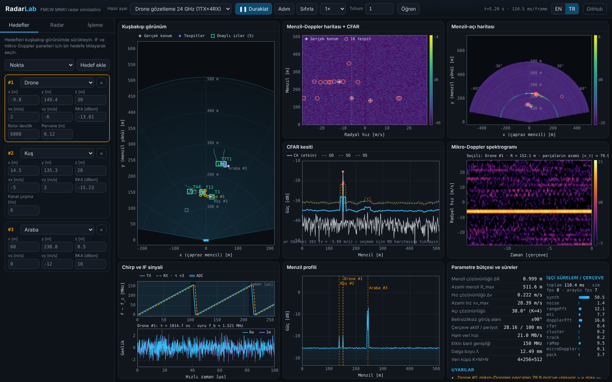 | 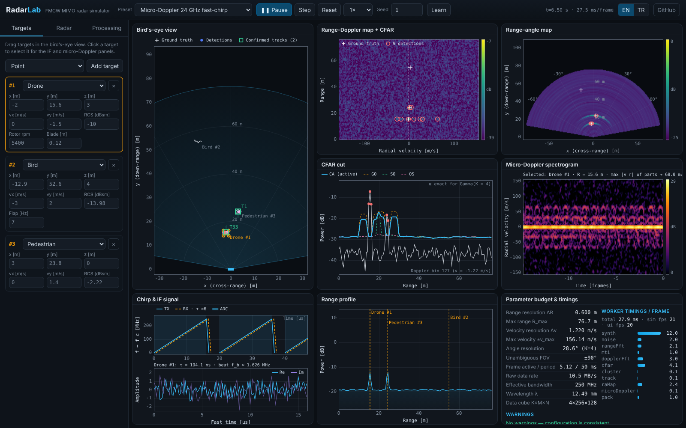 |

| Learn mode, CFAR step | Tablet | Mobile |
|---|---|---|
| 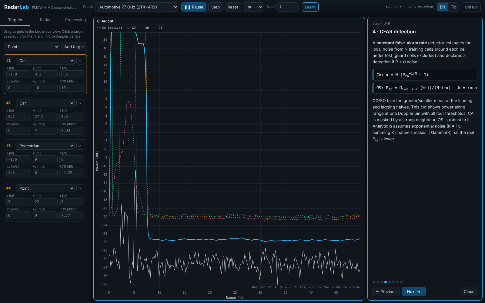 | 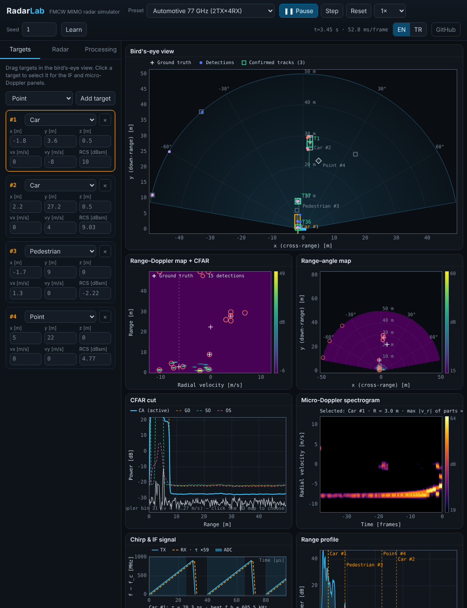 | 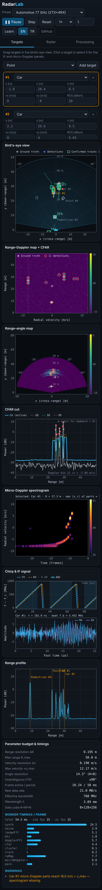 |

---

## 8 Working with real hardware

RadarLab reads the configuration and raw data formats of TI mmWave sensors with the DCA1000EVM capture card [33, 34].

**Configuration.** `radarlab.io.parse_ti_cfg` reads an mmWave SDK / mmWave Studio CLI `.cfg` file (`profileCfg`, `chirpCfg`, `frameCfg`, `channelCfg`, `adcCfg`) and returns a `TiCfg` whose `.config` is a `RadarConfig`. The mapping is $f_c$ = `startFreq` (chirp start frequency), $S$ = `freqSlopeConst`, $f_s$ = `digOutSampleRate`, $N$ = `numAdcSamples`, $T_c$ = `idleTime + rampEndTime`, $M$ = `numLoops`, $n_{Tx}$ = chirps per loop (one TX per chirp), and the antenna positions come from the device geometry of the enabled elements (AWR1843, IWR1843, IWR6843ISK, AWR1642).

**Raw data.** `radarlab.io.read_dca1000` reads the int16 little-endian LVDS stream of xWR16xx/18xx/68xx devices (two lanes; per chirp all N samples of RX0, then RX1, …; complex words in groups [I0, I1, Q0, Q1]) and returns cubes of shape (F, K, M, N) in the layout of Section 2. `write_dca1000` writes the same format.

**Closed loop.** The test `test_closed_loop_cfg_sim_dca_process` (and V11) parses a 3-TX AWR1843 `.cfg`, simulates a frame, quantises it to 16-bit codes, writes a DCA1000 `.bin`, reads it back and processes it. The codes are identical after the round trip and the detections are the same as for the floating-point cube.

**Running on an AWR1843 capture.**

```python
import radarlab as rl
from radarlab.io import parse_ti_cfg, read_dca1000

ti = parse_ti_cfg("profile.cfg", device="awr1843")   # the .cfg used for the capture
cfg = ti.config
cubes = read_dca1000("adc_data.bin", cfg)             # (F, K, M, N), raw ADC codes
res = rl.process_frame(cubes[0].astype(complex), cfg,
                       rl.ProcessingParams(cfar_kind="os", cfar_pfa=1e-6))
print(res.points[["range", "velocity", "azimuth", "snr_db"]])   # azimuth in rad
```

Two practical points. First, the IQ order depends on the IQ-swap setting of mmWave Studio; check it with a corner reflector at a known range (the correct order gives one peak at the positive range bin, the wrong order mirrors it). Second, check the sign of the angle axis with a corner reflector at a known azimuth, because board antenna ordering can flip it. Public DCA1000 datasets such as RaDICaL [35] and ColoRadar [36] can be used in the same way.

**Validation on public real data.** `radarlab.io.uw_mat.load_uw_mat` reads the University of Washington AWR1843 template captures (Gao et al., Asilomar 2019; MIT licence): pedestrian, cyclist and parked car, 30 frames each. It returns (F, K, M, N) cubes and a `RadarConfig` built from the published configuration (77 GHz, 21.0017 MHz/µs, 4 Msps, 128 samples, 255 loops, TX0/TX2 TDM, 120 µs per TX cycle). The TX order, TX spacing and I/Q sign were checked on the data itself. The ADC start time is not published, and to first order it cannot be observed from the data.

The unchanged processing chain runs on the real frames (`python/examples/real_data/`). Away from zero Doppler, the real range–Doppler noise follows a Gamma(8) distribution (KS p 0.17–0.28). The CA-CFAR with exact α gives 1.12–1.18× the nominal false-alarm rate at Pfa 1e-3, against 1.09–1.14× for simulated noise.

The simulated counterparts have their trajectory, amplitude and noise fitted to the data. They reproduce the dominant target within 0.2 m, 0.08 m/s and 1°. Switching on the IF high-pass, DC offset, static clutter and a measured channel gain/phase mismatch brings the simulation close to the real data:

- noise-floor shape error: 2.4 → 1.0 dB;
- zero-Doppler detections: 1.6 → 8.4 per frame (real: 9.6);
- array coherence: 1.00 → 0.93 (real: 0.92).

The simulation does not yet reproduce:

- the DC/leakage Doppler skirt (7.3 near-DC false alarms per frame);
- aliased far clutter;
- the strong RCS fluctuation of the pedestrian;
- the micro-Doppler of a very slow walker and of a cyclist starting from rest (limb Doppler extent off by about ±60 %).

Details and limitations (only 1 s per scene, no ground truth, fits made on the same data) are in [`docs/real_data/report.md`](docs/real_data/report.md).

---

## 9 Getting started

### 9.1 Python reference

```bash
git clone https://github.com/EnesErdogans/radarlab.git
cd radarlab
pip install -e "python[dev]"            # numpy, scipy; dev adds pytest and matplotlib
cd python
pytest -m "not slow"                    # fast suite
pytest -m slow                          # Monte-Carlo, paper-grade sizes
python scripts/export_golden.py         # regenerate ../golden/*.json
```

Quick start:

```python
import radarlab as rl

cfg = rl.automotive_77ghz()                     # 2TX x 4RX, 8-element virtual ULA
scene = rl.Scene([
    rl.Car((-3.5, 40, 0), (0, -8, 0), wheels=True),
    rl.Pedestrian((6, 15, 0), (-1.3, 0, 0)),
    rl.PointTarget.from_polar(25.0, 12.0, radial_velocity=-5.0, rcs=5.0),
])
cube = rl.simulate_frame(cfg, scene, rng=1)      # (K, M, N) complex, noise variance 1
res = rl.process_frame(cube, cfg, rl.ProcessingParams(cfar_kind="os"))
res.power_db                                     # RD map (Nr, M), Doppler fftshifted
res.points[["range", "velocity", "azimuth", "snr_db"]]

from radarlab.track import Tracker              # frame stepping + tracking
sim = rl.Simulator(cfg, scene, tracker=Tracker(), seed=0)
for fr in sim.run(20):
    print([(t.id, t.position.round(1)) for t in fr.tracks])
```

### 9.2 Figures and validation report

```bash
cd python/examples
python rd_map_automotive.py
python micro_doppler.py
python micro_doppler_regimes.py
python cfar_pfa.py
python rmse_crlb.py
python validation_report.py            # full report (theory validations + consistency checks); --quick for small sizes
```

Outputs are written to `python/examples/out/`.

### 9.3 Web application

```bash
cd web
npm ci
npm run dev        # development server (Vite)
npm test           # Vitest, including golden vectors
npm run build      # type-check and production build to web/dist
```

The Pages workflow ([`.github/workflows/pages.yml`](.github/workflows/pages.yml)) runs the web tests and then deploys `web/dist` on every push to `main`. A build that fails its tests is not deployed.

### 9.4 Repository layout

```
radarlab/
├── docs/
│   ├── PROJECT_BRIEF.md          binding conventions (signal model, signs, layout)
│   └── literature/               review, references.bib, fidelity requirements, paper positioning
├── python/                       reference implementation (pip package "radarlab")
│   ├── src/radarlab/
│   │   ├── config.py             RadarConfig, derived quantities, presets
│   │   ├── scene.py              point, car, pedestrian, drone, bird, clutter
│   │   ├── signal.py             exact beat synthesis, amplitude modes, leakage
│   │   ├── impairments.py        Swerling, ADC, IF filter, phase noise, IQ, two-ray, interference
│   │   ├── dsp/                  windows, FFT, CFAR, detection, DoA, point cloud, micro-Doppler
│   │   ├── track/                EKF tracker
│   │   ├── io/                   TI .cfg parser, DCA1000 reader/writer
│   │   ├── metrics.py            CRLB, ML estimator, analytic Pd
│   │   ├── pipeline.py           simulate_frame, process_frame, Simulator
│   │   ├── golden.py             golden-vector case builders
│   │   └── validation.py         validation matrix (V1–V11, V8f; theory vs consistency)
│   ├── tests/                    pytest
│   ├── examples/                 figure scripts; output in examples/out/
│   └── scripts/export_golden.py
├── golden/                       cross-language golden vectors (JSON)
├── web/                          Vite + TypeScript app
│   ├── src/{config,sim,dsp,track,engine,ui}/
│   ├── tests/                    Vitest
│   └── docs/screenshots/
└── .github/workflows/            ci.yml, pages.yml
```

---

## 10 Limitations and roadmap

**Current limitations.**

- **Scene realism.** Targets are point or extended-scatterer models. There is no ray tracing, no aspect-dependent RCS, no element patterns and no distributed (σ⁰) clutter.
- **Elevation without a planar array.** For arrays without vertical diversity φ is taken as 0, so targets with z ≠ 0 are reported at asin(sinθ·cosφ), a bias of 0.29° at φ = 10° (Section 5.5).
- **Impairments in the web engine.** Phase noise, leakage, IQ imbalance, ADC, IF filters, multipath and interference exist only in Python. The web drone uses a point-blade model, not the line-blade model.
- **Approximations.** The two-ray mixed path is placed on the direct line of sight (approximate elevation). Interference uses an ideal low-pass mask. GO/SO factors at range edges use n = min(halves). For $\lvert v\rvert > v_{\max}$, TDM compensation uses the aliased velocity, so the angle is biased. SW2/SW4 decorrelate per chirp, not per frame and channel.
- **Window correlation.** Analytic CFAR results hold for rectangular windows; with Hann the false-alarm rate is about 1.6 times the design value (V1c).
- **Tracker.** Constant-velocity EKF without IMM. The Python tracker has no extended-target merging, so one car can produce several tracks. In the web application, extended targets can briefly create an extra track.
- **Web performance.** Synthesis dominates the frame time; the drone preset does not reach real time on the test machine. The spectrogram time axis is in frames and does not show gaps.
- **Real data.** The DCA1000 path is validated in a closed loop with simulated data. Validation on public raw captures and own AWR-series captures is not yet done.

**Roadmap.**

1. TI IF-filter model (two first-order HPF sections at the TI corner frequencies, 4th-order LPF) and chirp nonlinearity.
2. Element patterns and channel calibration errors, distributed clutter, Fresnel reflection coefficient for multipath, full Boulic pedestrian model.
3. Simulation vs real data on public DCA1000 datasets and own AWR1843 captures (noise floor, phase-noise skirt, corner reflector, fan or drone micro-Doppler).
4. Selected impairments in the web engine; WebAssembly SIMD for synthesis; upload of real captures in the browser.
5. Drone vs bird micro-Doppler case study with a simple classifier.

---

## Citation

If you use RadarLab, please cite it as software (see also [`CITATION.cff`](CITATION.cff)):

```bibtex
@software{erdogan2026radarlab,
  author  = {Erdo{\u{g}}an, Enes},
  title   = {{RadarLab}: An Open-Source {FMCW} {MIMO} Radar Simulator with a Browser Twin, Validated Against Detection and Estimation Theory},
  year    = {2026},
  version = {0.1.0},
  url     = {https://github.com/EnesErdogans/radarlab},
  license = {MIT}
}
```

## License

RadarLab is released under the [MIT License](LICENSE). Copyright (c) 2026 Enes Erdoğan.

## Acknowledgements

**AI usage disclosure.** Development of this software was AI-assisted. Large parts of the code, tests, documentation and the literature review were written with Anthropic's Claude (Claude Code) under the direction of the author. The author defined the goals and conventions, reviewed the results, and is responsible for the content. Correctness is checked by the analytic tests, the cross-language golden vectors and the validation matrix described in Section 6. Bibliographic entries marked "unverified" in [`docs/literature/references.bib`](docs/literature/references.bib) were not checked against the primary source.

## References

[1] S. M. Patole, M. Torlak, D. Wang and M. Ali, "Automotive Radars: A Review of Signal Processing Techniques", *IEEE Signal Processing Magazine*, vol. 34, no. 2, pp. 22–35, 2017. doi:[10.1109/MSP.2016.2628914](https://doi.org/10.1109/MSP.2016.2628914).

[2] S. Sun, A. P. Petropulu and H. V. Poor, "MIMO Radar for Advanced Driver-Assistance Systems and Autonomous Driving: Advantages and Challenges", *IEEE Signal Processing Magazine*, vol. 37, no. 4, pp. 98–117, 2020. doi:[10.1109/MSP.2020.2978507](https://doi.org/10.1109/MSP.2020.2978507).

[3] C. Schüßler et al., "A Realistic Radar Ray Tracing Simulator for Large MIMO-Arrays in Automotive Environments", *IEEE Journal of Microwaves*, vol. 1, no. 4, pp. 962–974, 2021. doi:[10.1109/JMW.2021.3104722](https://doi.org/10.1109/JMW.2021.3104722).

[4] K. Bansal, G. Reddy and D. Bharadia, "SHENRON – Scalable, High Fidelity and Efficient Radar Simulation", *IEEE Robotics and Automation Letters*, vol. 9, no. 2, pp. 1644–1651, 2024. <https://github.com/Kshitizbansal/shenron-radar-simulator>

[5] Z. F. Magosi et al., "A Survey on Modelling of Automotive Radar Sensors for Virtual Test and Validation of Automated Driving", *Sensors*, vol. 22, no. 15, art. no. 5693, 2022. doi:[10.3390/s22155693](https://doi.org/10.3390/s22155693).

[6] Z. Peng, "RadarSimPy: A Radar Simulator for Python (v8.3.0)", Zenodo, 2022. doi:[10.5281/zenodo.6792269](https://doi.org/10.5281/zenodo.6792269).

[7] The MathWorks, "Radar Toolbox Documentation: Automotive Radar", 2026. <https://www.mathworks.com/help/radar/automotive-radar.html>

[8] A. Gupta et al., "OpenRadar: A Toolkit for Prototyping mmWave Radar Applications", 2019.

[9] H. Cui, J. Wu and N. Dahnoun, "Millimetre-wave Radar for Low-Cost 3D Imaging: A Performance Study", arXiv preprint; code: <https://github.com/yizzfz/mmSim>, 2023. (arXiv identifier unverified.)

[10] C. Fahnemann, N. Rother and H. Blume, "Interactive Synthetic Aperture Radar Simulator Generating and Visualizing Realistic FMCW Data", *Proc. International Conference on Radar Systems (RADAR 2022)*, pp. 725–730, 2022. doi:[10.1049/ICP.2023.1281](https://doi.org/10.1049/ICP.2023.1281).

[11] R. Boulic, N. Magnenat-Thalmann and D. Thalmann, "A Global Human Walking Model with Real-Time Kinematic Personification", *The Visual Computer*, vol. 6, no. 6, pp. 344–358, 1990. doi:[10.1007/BF01901021](https://doi.org/10.1007/BF01901021). (Volume, number and pages unverified.)

[12] V. C. Chen, "The Micro-Doppler Effect in Radar", *Artech House*, 2019.

[13] J. Martin and B. Mulgrew, "Analysis of the Theoretical Radar Return Signal from Aircraft Propeller Blades", *Proc. IEEE International Radar Conference*, pp. 569–572, 1990. (Record not retrievable; details unverified.)

[14] S. Rahman and D. A. Robertson, "Radar Micro-Doppler Signatures of Drones and Birds at K-band and W-band", *Scientific Reports*, vol. 8, art. no. 17396, 2018. doi:[10.1038/s41598-018-35880-9](https://doi.org/10.1038/s41598-018-35880-9).

[15] P. Swerling, "Probability of Detection for Fluctuating Targets", *IRE Transactions on Information Theory*, vol. 6, no. 2, pp. 269–308, 1960. doi:[10.1109/TIT.1960.1057561](https://doi.org/10.1109/TIT.1960.1057561).

[16] M. C. Budge Jr. and M. P. Burt, "Range Correlation Effects in Radars", *Record of the 1993 IEEE National Radar Conference*, pp. 212–216, 1993. doi:[10.1109/NRC.1993.270463](https://doi.org/10.1109/NRC.1993.270463).

[17] K. Siddiq, M. K. Hobden, S. R. Pennock and R. J. Watson, "Phase Noise in FMCW Radar Systems", *IEEE Transactions on Aerospace and Electronic Systems*, vol. 55, no. 1, pp. 70–81, 2019. doi:[10.1109/TAES.2018.2847999](https://doi.org/10.1109/TAES.2018.2847999).

[18] A. Melzer, A. Onic, F. Starzer and M. Huemer, "Short-Range Leakage Cancelation in FMCW Radar Transceivers Using an Artificial On-Chip Target", *IEEE Journal of Selected Topics in Signal Processing*, vol. 9, no. 8, pp. 1650–1660, 2015. doi:[10.1109/JSTSP.2015.2465298](https://doi.org/10.1109/JSTSP.2015.2465298).

[19] Texas Instruments, "AWR1843 Single-Chip 77- and 79-GHz FMCW Radar Sensor (Datasheet)", Doc. SWRS222D, 2024. <https://www.ti.com/lit/gpn/awr1843>

[20] R. Feger, C. Wagner and A. Stelzer, "A W-Band Heterodyne FMCW Radar Based on TX IQ-Modulation", *Frequenz*, vol. 65, no. 7–8, pp. 183–191, 2011. doi:[10.1515/freq.2011.026](https://doi.org/10.1515/freq.2011.026).

[21] S. Kohnert, M. Vogt and R. Stolle, "FMCW Radar Height Estimation of Moving Vehicles by Analyzing Multipath Reflections", 2023. (Publication venue unverified.)

[22] M. Goppelt, H. Blöcher and W. Menzel, "Automotive Radar – Investigation of Mutual Interference Mechanisms", *Advances in Radio Science*, vol. 8, pp. 55–60, 2010. doi:[10.5194/ars-8-55-2010](https://doi.org/10.5194/ars-8-55-2010).

[23] M. Kronauge and H. Rohling, "Fast Two-Dimensional CFAR Procedure", *IEEE Transactions on Aerospace and Electronic Systems*, vol. 49, no. 3, pp. 1817–1823, 2013. doi:[10.1109/TAES.2013.6558022](https://doi.org/10.1109/TAES.2013.6558022).

[24] P. P. Gandhi and S. A. Kassam, "Analysis of CFAR Processors in Nonhomogeneous Background", *IEEE Transactions on Aerospace and Electronic Systems*, vol. 24, no. 4, pp. 427–445, July 1988. doi:10.1109/7.7185. (Volume, issue, pages and date confirmed in review round 1. Citing works print the title in different ways, as "Analysis of *some* CFAR processors…" or "…in *homogeneous* background". The title and DOI were not checked on IEEE Xplore.)

[25] H. Rohling, "Radar CFAR Thresholding in Clutter and Multiple Target Situations", *IEEE Transactions on Aerospace and Electronic Systems*, vol. 19, no. 4, pp. 608–621, 1983. doi:[10.1109/TAES.1983.309350](https://doi.org/10.1109/TAES.1983.309350). (Volume, issue and pages confirmed in review round 1; DOI not checked.)

[26] J. Bechter, F. Roos and C. Waldschmidt, "Compensation of Motion-Induced Phase Errors in TDM MIMO Radars", *IEEE Microwave and Wireless Components Letters*, vol. 27, no. 12, pp. 1164–1166, Dec. 2017. (Details confirmed in review round 1; DOI not checked.)

[27] J. Capon, "High-Resolution Frequency-Wavenumber Spectrum Analysis", *Proceedings of the IEEE*, vol. 57, no. 8, pp. 1408–1418, 1969. doi:[10.1109/PROC.1969.7278](https://doi.org/10.1109/PROC.1969.7278).

[28] R. O. Schmidt, "Multiple Emitter Location and Signal Parameter Estimation", *IEEE Transactions on Antennas and Propagation*, vol. 34, no. 3, pp. 276–280, 1986. doi:[10.1109/TAP.1986.1143830](https://doi.org/10.1109/TAP.1986.1143830).

[29] Y. Bar-Shalom, X. R. Li and T. Kirubarajan, "Estimation with Applications to Tracking and Navigation", *Wiley*, 2001. (Details unverified.)

[30] M. A. Richards, "Fundamentals of Radar Signal Processing", *McGraw-Hill Education*, 2014.

[31] D. C. Rife and R. R. Boorstyn, "Single Tone Parameter Estimation from Discrete-Time Observations", *IEEE Transactions on Information Theory*, vol. 20, no. 5, pp. 591–598, 1974. doi:[10.1109/TIT.1974.1055282](https://doi.org/10.1109/TIT.1974.1055282).

[32] S. M. Kay, "Fundamentals of Statistical Signal Processing, Volume I: Estimation Theory", *Prentice Hall*, 1993. (Details unverified.)

[33] Texas Instruments, "Mmwave Radar Device ADC Raw Data Capture", Application report SWRA581B, 2018. <https://www.ti.com/lit/swra581>

[34] Texas Instruments, "mmWave SDK User Guide, Product Release 3.2.0 (AOP)", 2019. <https://software-dl.ti.com/ra-processors/esd/MMWAVE-SDK-AOP/03_02_00_06_AOP/exports/mmwave_sdk_user_guide.pdf>

[35] T.-Y. Lim et al., "RaDICaL: A Synchronized FMCW Radar, Depth, IMU and RGB Camera Data Dataset with Low-Level FMCW Radar Signals", *Illinois Data Bank, IDB-3289560*, 2021. <https://publish.illinois.edu/radicaldata/> (Authors, exact title and associated paper venue unverified.)

[36] A. Kramer, K. Harlow, C. Williams and C. Heckman, "ColoRadar: The Direct 3D Millimeter Wave Radar Dataset", 2021. (Journal version (IJRR) unverified.)

[37] M. Shor and N. Levanon, "Performances of Order Statistics CFAR", *IEEE Transactions on Aerospace and Electronic Systems*, vol. 27, no. 2, pp. 214–224, 1991. doi:[10.1109/7.78295](https://doi.org/10.1109/7.78295).

[38] J. A. Ritcey, "Detection Analysis of the MX-MLD with Noncoherent Integration", *IEEE Transactions on Aerospace and Electronic Systems*, vol. 26, no. 3, pp. 569–576, 1990. doi:[10.1109/7.106136](https://doi.org/10.1109/7.106136).
