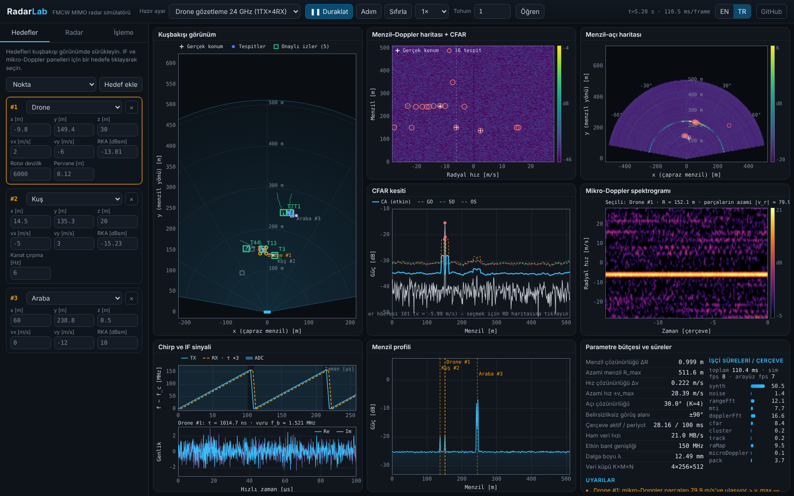

# RadarLab

**FMCW TDM-MIMO radar için açık kaynak simülatör: NumPy referans uygulaması, TypeScript ile tarayıcı ikizi ve tespit/kestirim teorisine karşı doğrulama.**

[](https://github.com/EnesErdogans/radarlab/actions/workflows/ci.yml)
[](LICENSE)

**Canlı demo:** <https://eneserdogans.github.io/radarlab/> (kurulum gerektirmez; `?lang=tr` ile Türkçe arayüz)

Enes Erdoğan, Elektrik-Elektronik Mühendisliği Bölümü, Abdullah Gül Üniversitesi, Kayseri, Türkiye

> Ayrıntılı, makale biçimindeki İngilizce belge: **[README.md](README.md)**. Bu sayfa kısa bir Türkçe özettir.



## Özet

RadarLab, zaman bölmeli MIMO (TDM-MIMO) dizili FMCW radarların benzetimi ve sinyal işlemesi için açık kaynaklı bir çerçevedir. İki uygulaması vardır. Python uygulaması referanstır: artık video fazı (RVP), chirp içi hareket ve TDM zamanlaması dahil kesin vuru (beat) sinyalini üretir; menzil korelasyonlu faz gürültüsü, Tx–Rx sızıntısı, IQ dengesizliği, nicemleme, yer yansımalı çok yollu yayılım ve FMCW girişimi gibi donanım bozulmalarını modeller. TypeScript uygulaması aynı zinciri tarayıcıda bir Web Worker içinde etkileşimli hızda çalıştırır. İki uygulamanın sayısal olarak aynı sonucu verdiği, diller arası altın test vektörleriyle (golden vectors) sürekli entegrasyonda denetlenir. İşleme zinciri: pencereli menzil ve Doppler FFT, MTI, K sanal kanal üzerinde evre uyumsuz toplama için kesin Gamma(K) eşikli CA/GO/SO/OS-CFAR, FFT/MVDR/MUSIC ile geliş açısı kestirimi, kümeleme, EKF izleyici ve mikro-Doppler analizi. On bir doğrulama deneyi (V1–V11) simülatörü kapalı form teoriyle karşılaştırır; hepsi geçer.

## Öne çıkan sonuçlar

Tüm sayılar `python/examples/out/validation_report.md` dosyasından alınmıştır.

- **Yanlış alarm (V1):** Dikdörtgen pencereyle, sabit/CA/OS/GO/SO detektörleri için K = 1 ve K = 8'de benzetim Pfa değeri tasarım değerine çok yakındır (en büyük |log10 oran| 0.034).
- **Hann penceresi (V1c):** Komşu gürültü hücreleri arasında −2/3 korelasyon oluşur (ölçülen −0.6725); CA-CFAR yanlış alarm oranı tasarım değerinin yaklaşık 1.6 katına çıkar.
- **Tespit olasılığı (V2):** Swerling 0/1/3, K = 1 ve 8 için 30 noktanın 29'u teorinin %95 güven aralığı içindedir.
- **CRLB (V3):** Eşik bölgesinin üstünde menzil, hız ve açı kestiricilerinin verimliliği 0.957–1.041 arasındadır.
- **Gamma(K) CFAR:** Tek kanal CA formülü K kanalın toplamına uygulanırsa eşik, K = 4–8 ve N = 16–32 eğitim hücresi için 4.1–6.1 dB fazla yüksek olur (`golden/cfar_alpha.json`, tasarım Pfa = 10⁻⁴).
- **DCA1000 kapalı döngü (V11):** `.cfg` → benzetim → int16 `.bin` → okuma → işleme zincirinde kodlar birebir aynı kalır ve tespitler değişmez.
- **Testler:** Python 114 hızlı + 7 yavaş (Monte-Carlo) test; web 79 test (Vitest). Hepsi geçiyor.

## Hızlı başlangıç

```bash
git clone https://github.com/EnesErdogans/radarlab.git
cd radarlab
pip install -e "python[dev]"
cd python && pytest -m "not slow"          # Python testleri
cd ../web && npm ci && npm test            # web testleri (altın vektörler dahil)
npm run dev                                # yerel geliştirme sunucusu
```

Gerçek TI verisi (ör. AWR1843 + DCA1000):

```python
import radarlab as rl
from radarlab.io import parse_ti_cfg, read_dca1000

ti = parse_ti_cfg("profile.cfg", device="awr1843")
cubes = read_dca1000("adc_data.bin", ti.config)           # (F, K, M, N)
res = rl.process_frame(cubes[0].astype(complex), ti.config)
print(res.points[["range", "velocity", "azimuth", "snr_db"]])
```

## Web uygulaması

Sekiz panel (kuşbakışı görünüm ve izler, chirp/IF sinyali, menzil profili, menzil–Doppler haritası ve CFAR, CFAR kesiti, menzil–açı haritası, mikro-Doppler spektrogramı, parametre bütçesi) ve sekiz adımlı Türkçe/İngilizce **Öğrenme modu** vardır. URL parametreleri: `?preset=micro|drone`, `?lang=tr`, `?learn=0..7`, `?paused`.

## Sınırlamalar

Sahne modeli nokta ve genişletilmiş saçıcılardan oluşur (ışın izleme yok). Web motorunda kesin Gamma(K) eşiği yalnızca CA-CFAR için vardır; GO/SO/OS K = 1 formüllerini kullanır (K > 1 için tutucu). Faz gürültüsü, sızıntı, IQ dengesizliği gibi bozulmalar şimdilik yalnızca Python'dadır. Gerçek ölçümlerle karşılaştırma henüz yapılmadı. Ayrıntılar için [README.md](README.md) Bölüm 10'a bakın.

## Atıf, lisans ve yapay zekâ kullanımı

Atıf bilgisi [`CITATION.cff`](CITATION.cff) dosyasındadır. Lisans: [MIT](LICENSE). Bu yazılımın geliştirilmesinde Anthropic'in Claude modelinden (Claude Code) yardım alınmıştır; hedefler ve kurallar yazar tarafından belirlenmiş, sonuçlar yazar tarafından gözden geçirilmiştir. Doğruluk, README.md Bölüm 6'da anlatılan testler ve doğrulama matrisiyle denetlenir.
