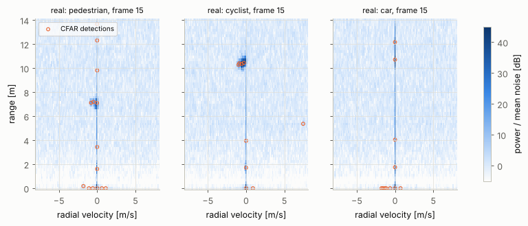
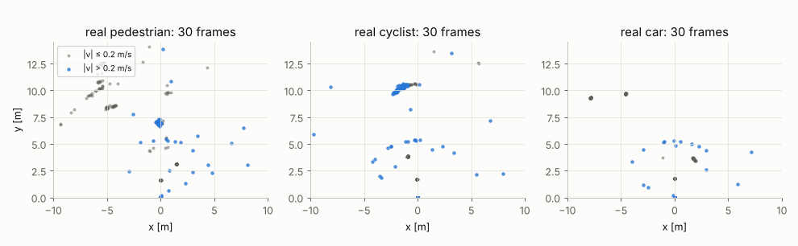
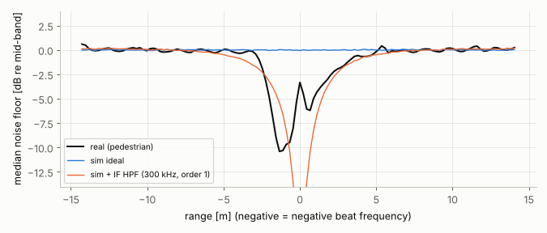
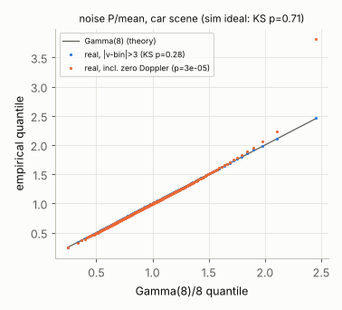
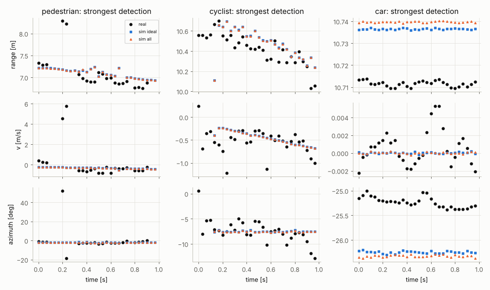
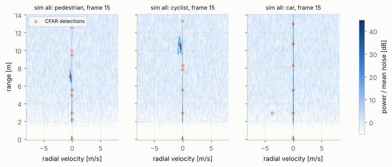
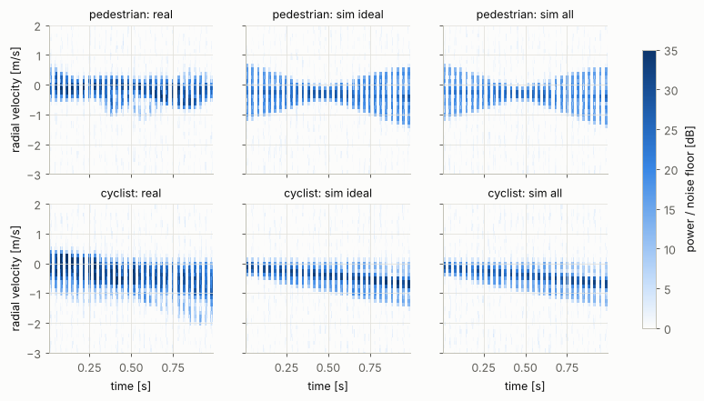

# RadarLab vs. real AWR1843 data (UW template captures)

Date: 2026-11-24. Scripts: `python/examples/real_data/01…05_*.py`. Every number comes from `docs/real_data/results/*.json`; the full tables are in `results/tables.md` (written by `05_tables.py`). Every figure in `fig/` is made by these scripts.

## 1 Summary

We ran the unchanged radarlab chain on three public AWR1843 raw-ADC captures (pedestrian, cyclist, parked car; 30 frames each), and on simulated copies that use the same configuration.

- **Away from zero Doppler, noise and CFAR behave as the model assumes.** The noise fits Gamma(8) (shape 7.88–7.95, KS p 0.17–0.28). In target-free cells the CFAR false-alarm rate is 1.12–1.18× nominal at Pfa 1e-3; the ideal simulation gives 1.09–1.14×.
- **At zero Doppler they do not.** These cells hold static content: the Gamma test fails (p ≤ 3e-5) and the false-alarm rate is 10–22× nominal at 1e-4.
- **The dominant target is reproduced** within 0.2 m, 0.08 m/s and 1°. Its trajectory and amplitude were fitted to the same data, so this is mainly a consistency check, not an accuracy test.
- **The real data shows clear real-world effects:** an IF high-pass notch around DC, a DC offset per channel with a Doppler skirt (7.3 near-DC false detections per frame), static clutter (9.6 zero-Doppler detections per frame), array gain/phase mismatch (coherence 0.92), and an IQ image at least 39 dB down.
- **With the radarlab impairments on, the simulation moves towards the real data:**

  | Quantity | Ideal sim | Sim + impairments | Real |
  |---|---|---|---|
  | Detections per frame | 3.3 | 10.7 | 19.8 |
  | Zero-Doppler detections per frame | 1.6 | 8.4 | 9.6 |
  | Noise-floor shape error [dB] | 2.4 | 1.0 | – |
  | Array coherence | 1.000 | 0.930 | 0.922 |

- **Not explained:** the DC Doppler skirt and the asymmetric notch.
- **Micro-Doppler is only partly right.** For the very slow real walker, the simulated pedestrian has about 70 % more limb extent (1.08 vs 0.63 m/s). The simulated cyclist has less than the real one (0.63 vs 1.01 m/s). Cadence cannot be measured from 1 s of data.

## 2 Data

- **Source:** Gao, Xing, Roy, Liu, "Experiments with mmWave Automotive Radar Test-bed", Asilomar 2019, DOI 10.1109/IEEECONF44664.2019.9048939.
- **Files:** `template data/{pms,bms,cms}1000_30fs.mat` from github.com/Xiangyu-Gao/mmWave-radar-signal-processing-and-microDoppler-classification (MIT licence).
- **md5:**
  - pms: 7d89f3e9e4d78bbd37d35e9fdb1a42fa
  - bms: 629ef0276ad54911859348b105d48513
  - cms: 61a1298d0c5fcee28cef227f4ba8c49e
- **Content:** `data_frames` (4 RX, 30·255·2·128), integer ADC codes, noise σ ≈ 7.6 LSB. The files are stored outside the repository and are never committed.
- **Safety:** the files are treated as untrusted. They are read only with `loadmat(variable_names=[…])` plus a 2-D numeric check, and all scripts run with `python -I`.

## 3 Loader and configuration (`radarlab.io.uw_mat`)

`load_uw_mat(path)` returns cubes of shape (F, K, M, N) with k = t·nRx + r. `uw_awr1843_config()` builds the configuration.

**Published values** (from the paper and the repository files `get_params_value.m` and `generate_ra_3dfft.m`):

| Parameter | Value |
|---|---|
| Carrier fc | 77 GHz |
| Slope | 21.0017 MHz/µs |
| Sample rate | 4 Msps, complex |
| Samples per chirp N | 128 |
| Chirp loops M | 255 |
| Chirp period | 60 µs per chirp, 120 µs per TX cycle |
| TX | TX0 + TX2 (2λ apart), TDM; odd chirps are the first TX |
| RX | 4 elements at λ/2 |
| Frame rate | 30 fps |

**Derived:** ΔR 0.223 m, Rmax 28.6 m (14.3 m usable), Δv 0.064 m/s, vmax 8.11 m/s.

**Assumed (not published):** adcStartTime 6 µs, idle time 10 µs.

**Checks on the data** (`01_loader_checks.py`):

- **TX order and spacing.** These were tested on the parked car, a static point target at −25°:

  | Hypothesis | Coherence |
  |---|---|
  | Order (0,1), 2λ spacing | 0.926 (θ̂ −25.2°) |
  | Order swapped | 0.754 |
  | 1λ spacing | 0.279 |
  | 3λ spacing | 0.769 |

  The first hypothesis was adopted. Targets near boresight cannot separate these hypotheses.
- **I/Q sign.** 84 % (pedestrian) and 90 % (cyclist) of the moving power lies at positive beat frequency. The pedestrian's fitted range rate (−0.38 m/s) has the same sign as its Doppler velocity (−0.54 m/s), so no conjugation is needed.
- **adcStartTime cannot be observed.** Simulating 0, 6 and 12 µs changes range by 2e-5 m, velocity by 0.17 % per 6 µs, and azimuth by 1e-4°.
- **No fast-time transient.** The first and last 4 samples are within ±11 % of mid-chirp.
- **DC offset:** 1.3–25 LSB per channel.
- **Tests.** `test_uw_mat.py` uses synthetic files only. It checks the index layout against an independent copy of the MATLAB indexing, TX order and conjugation, a write/read round trip, a simulated target recovered through a `.mat` file, and rejection of bad files.

## 4 Processing chain (identical for real and simulated data)

- `process_frame` with default parameters:
  - Hann window in range and Doppler;
  - CA-CFAR with guard (2,2), training (8,4), Pfa 1e-5 and the exact Gamma(8) α;
  - clustering, TDM compensation, and a 64-point FFT for direction of arrival.
- **Micro-Doppler:**
  1. Range FFT, then remove the slow-time mean in each frame.
  2. Collect slow time over 30 frames (TX0 chirps only).
  3. STFT with a 128-chirp Hann window (15.4 ms, 0.127 m/s) and a hop of 8.
  4. Sum the power over the 4 RX channels and the target's range band.
  5. Drop columns that straddle a frame boundary (a 2.7 ms gap).
- **Scaling:** real cubes are divided by the fitted σ, so real and simulated data are both in units of noise standard deviation.

 

## 5 What is fitted (`simbuild.fit_all`, `results/03_fit.json`)

The parameters below were fitted on the same data that is used for the comparison.

| Fitted quantity | Pedestrian | Cyclist | Car |
|---|---|---|---|
| Noise σ² [LSB²] | 58.0 | 57.4 | 57.8 |
| Torso velocity v0 [m/s] | −0.21 | −0.11 | 0 |
| Torso acceleration a [m/s²] | −0.20 | −0.58 | 0 |
| Range at t = 0 [m] | 7.23 | 10.57 | 10.71 |
| Azimuth [°] | −1.9 | −7.5 | −25.2 |
| snr_ref_db (1 m² at 10 m) [dB] | −7.5 | +1.6 | +5.6 |
| Implied RCS [dBsm] | −8.3 | +0.8 | +4.9 |

- The torso velocity follows v(t) = v0 + a·t and is fitted from the torso line in the micro-Doppler.
- The implied RCS comes from the default link budget (12 dBm, 10 + 10 dBi, NF 15 dB, L 3 dB), so it is uncertain by several dB.
- **IF high-pass:** 300 kHz, first order, fitted on bins with |bin| > 2.
- **IQ phase imbalance:** 1.27°, from a measured image rejection of 39.1 dB (a lower bound).
- **Channel gain and phase:** −4.3…+2.3 dB and −11…+13°. These were measured on the car and applied to the signal only; the channel noise powers already agree within ±5 %.
- **Clutter:** 150 random scatterers between 1 and 14 m, scaled to the median real zero-Doppler power.
- **DC offset:** measured per channel.
- **Phase noise:** the radarlab default.

**Assumed:** radar height 1 m, pedestrian height 1.75 m, Boulic gait model, a generic cyclist model (`targets.py`), and an end-on car. A side-on car gave azimuth −37° and coherence 0.65, so it was rejected.

## 6 Results

### 6.1 Main table

Each cell gives the range over the scenes. "+imp" means all impairments switched on.

| Quantity | Real | Sim ideal | Sim +imp | Verdict |
|---|---|---|---|---|
| Gamma shape, excluding 0-Doppler | 7.88–7.95 | 7.98–8.04 | 7.84–7.91 | ✔ |
| KS p, excluding 0-Doppler | 0.17–0.28 | 0.71–1.00 | 0.05–0.12 | ✔ |
| KS p, including 0-Doppler | ≤3e-5 | 0.8–1 (ped, cyc) | 0.1 | ✘ |
| False alarms / nominal at 1e-3 (~270 events) | 1.12–1.18 | 1.09–1.14 | 1.06–1.22 | ✔ |
| False alarms / nominal at 1e-4 (24–37 events) | 1.09–1.55 | 1.01–1.47 | 1.01–1.43 | ✔ |
| False alarms / nominal at 1e-5 (1–6 events) | 1.26–2.52 | 0.42–1.68 | 0.84–1.68 | too few events |
| False alarms / nominal at 1e-4, including 0-Doppler (ped, cyc) | 21.9, 10.5 | 0.98, 1.10 | 1.39, 0.98 | ✘ |
| Noise-floor shape rms error (\|bin\| > 2) | – | 2.4 dB | 1.0 dB | ✔ with HPF |
| Pedestrian R / v / az | 6.95 / −0.38 / −1.9 | 7.14 / −0.30 / −1.9 | same | ✔ fitted |
| Cyclist R / v / az | 10.43 / −0.52 / −7.5 | 10.50 / −0.44 / −7.6 | same | ✔ fitted |
| Car R / az | 10.71 / −25.2 | 10.74 / −26.2 | 10.74 / −26.3 | ✔ (1° bias from the extended car model) |
| Peak IQR ped / cyc / car [dB] | 16.5 / 5.7 / 0.2 | 3.4 / 4.2 / 0.0 | 3.2 / 4.2 / 0.0 | ✘ |
| Array coherence (ped, cyc) | 0.916, 0.927 | 1.000 | 0.930, 0.930 | ✔ out of sample |
| Detections per frame | 19.8 | 3.3 | 10.7 | partly |
| … at 0-Doppler | 9.6 | 1.6 | 8.4 | ✔ |
| … near DC | 7.3 | 0 | 2.0 | ✘ |
| Power fraction at 0-Doppler | 0.78 | 0.27 | 0.82 | ✔ |
| MD pedestrian: torso v / extent median / extent p95 / rms bw | −0.25 / 0.63 / 1.14 / 0.126 | −0.25 / 1.08 / 1.77 / 0.237 | −0.38 / 1.01 / 1.77 / 0.228 | ✘ |
| MD cyclist: torso v / extent / v max p95 / rms bw | −0.38 / 1.01 / +0.38 / 0.181 | −0.38 / 0.63 / −0.25 / 0.096 | −0.38 / 0.51 / −0.25 / 0.095 | ✘ |
| Cadence | not resolvable (autocorr. 0.08) | Boulic 2.8 s cycle | – | record too short |

### 6.2 Noise

 

- **The noise is consistent across channels.** σ is 7.57–7.62 LSB in all three captures, the channel powers agree within ±5 %, and the cross-channel correlation is |ρ| ≤ 0.04.
- **Cells near zero Doppler carry extra static energy.** Within ±3 Doppler bins of zero, the negative-beat half of the spectrum is 3–7 dB above the floor.
  - This is not the IQ image, because the image rejection is at least 39 dB.
  - The likely cause is static clutter beyond 14.3 m. Its beat frequency is above fs/2, so with complex IF it aliases into the negative half.
  - The simulator shows the same mechanism: the bumper of the simulated car sits at 15.2 m and gives a 14× false-alarm ratio when zero Doppler is included. However, the simulator has no anti-alias filter and no clutter beyond 14 m.
- **The noise floor has a notch** of −10 dB at −1.5 m. A 300 kHz high-pass reduces the shape error from 2.4 to 1.0 dB. Two parts remain unexplained:
  - the notch is asymmetric, which a real-coefficient filter cannot produce;
  - bins 0 and ±1 are filled by the DC skirt.

### 6.3 CFAR

- **Hann windowing:** about 10 % excess false alarms at 1e-3 appears in both real and simulated noise. This is the known effect of Hann windowing on the training cells (validation V1c). The exact Gamma(K) threshold therefore holds on real noise.
- **Full map:** the larger excess comes from clutter, DC and aliased far clutter at zero Doppler.

### 6.4 Dominant target

- **Range, velocity and angle agree,** but they were fitted, so this shows consistency, not accuracy.
- **The 1° car azimuth bias** comes from the car's rear corners falling in the same cell as the bumper.
- **The pedestrian is missed often.** In 8 of 30 frames the strongest detection with |v| > 0.2 m/s is missing or is a false alarm.
- **The real body fluctuates more than the model.** The pedestrian's peak IQR is 16.5 dB, against 3.4 dB in simulation. Swerling fluctuation is available in radarlab but was not fitted.

### 6.5 Ablation (mean over scenes)

| Variant | Detections/frame | At 0-Doppler | Near DC | 0-Doppler power fraction | Noise-floor error [dB] | Coherence |
|---|---|---|---|---|---|---|
| real | 19.8 | 9.6 | 7.3 | 0.78 | – | 0.922 |
| ideal | 3.3 | 1.6 | 0 | 0.27 | 2.4 | 1.000 |
| +HPF | 3.7 | 1.6 | 0 | 0.28 | 1.0 | 1.000 |
| +DC | 5.3 | 3.6 | 2.0 | 0.78 | 2.4 | 1.000 |
| +IQ | 3.5 | 1.7 | 0 | 0.27 | 2.4 | 1.000 |
| +mismatch | 3.3 | 1.6 | 0 | 0.28 | 2.4 | 0.929 |
| +phase noise | 3.3 | 1.6 | 0 | 0.27 | 2.4 | 1.000 |
| +clutter | 7.6 | 5.8 | 0 | 0.51 | 2.4 | 1.000 |
| all | 10.7 | 8.4 | 2.0 | 0.82 | 1.0 | 0.930 |

- **Each impairment fixes its own statistic.** Phase noise and IQ imbalance have no measurable effect at 7–11 m.
- **Most of the remaining gap is near-DC detections.** In the real data, range bin 0 is +7.5 dB over the floor at 0.13 m/s, +2 dB at 0.5 m/s, and about +3 dB above the notched floor at 4 m/s.
  - A constant DC offset cannot create this skirt, and neither can leakage with phase noise, because τ ≈ 0.
  - The likely cause is a DC term that changes from chirp to chirp (1/f noise or drift). radarlab does not model this yet.
- **The clutter differs in structure.** The real clutter is structured, while the model's is random; only its level was matched.

### 6.6 Micro-Doppler

- **Pedestrian:** a very slow walker; the torso slows from −0.2 to −0.4 m/s.
  - At this speed the Boulic relation gives a 2.8 s gait cycle.
  - The model uses full limb swing, so its extent is too large: median 1.08 vs 0.63 m/s, p95 1.77 vs 1.14 m/s, rms bandwidth 0.24 vs 0.13 m/s.
- **Cadence cannot be estimated.** The autocorrelation peak is only 0.08. The plot seems to show a step period of about 0.4 s, but the data does not support it.
- **Cyclist:** starts from rest with −0.58 m/s².
  - The real signature is broader than the model and has receding parts up to +0.38 m/s, probably a foot pushing off.
  - The rolling-wheel/pedal model cannot produce this.
- **These are target-model limits, not radar-model limits.** The impairments change the micro-Doppler features by at most about one velocity bin.

## 7 Missing effects and the matching radarlab change

| # | Effect in the real data | Matching radarlab change |
|---|---|---|
| 1 | Asymmetric HPF notch | Needs an IQ-specific filter model |
| 2 | DC offset | Add a `dc_offset` impairment |
| 3 | DC/leakage Doppler skirt | Missing; add 1/f IF noise or a slow random DC walk |
| 4 | Array gain/phase mismatch | Add a `channel_gain` impairment plus calibration |
| 5 | Clutter | `static_clutter` matches the level but not the structure |
| 6 | Aliased far clutter | Add an IF anti-alias LPF before sampling (oversampled synthesis) |
| 7 | IQ imbalance | Small effect at this signal level |
| 8 | Human RCS fluctuation | Swerling model exists but was not fitted |
| 9 | Slow gait, cyclist motion | Speed-dependent limb swing amplitude; a cyclist model |
| 10 | Multipath | Not tested |

## 8 Limitations

- Only 1 s of data per class, and one capture of each.
- No ground truth or corner reflector, so no absolute test of range bias or angle calibration.
- The fits are in-sample, except the channel mismatch, which was measured on the car and tested on the pedestrian and cyclist.
- adcStartTime, idle time, RX gain and the link budget are assumed.
- The TX order is inferred from one static target.
- The KS p-values are indicative only (2×2 subsampling, large n).
- Pfa at 1e-5 rests on only 1–6 events.
- The micro-Doppler uses only the columns inside one frame (16 of 31 per frame).
- The cyclist model, car orientation, clutter and radar height are generic or assumed.
- The aliased-clutter and DC-skirt explanations are hypotheses and have not been verified.

## 9 Reproduce

1. Download the three files into a folder `$D` with `curl -sSfL`, from `https://raw.githubusercontent.com/Xiangyu-Gao/mmWave-radar-signal-processing-and-microDoppler-classification/main/template%20data/<name>_30fs.mat`.
2. From `/tmp`, run the scripts in order: `python -I python/examples/real_data/0{1..5}_*.py --data $D`. This takes about 7 min; step 03 takes about 4 min of that.
3. Run `pytest python/tests/test_uw_mat.py`.
