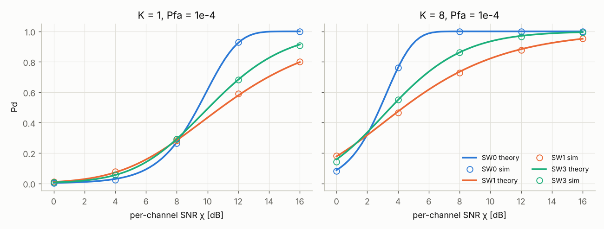
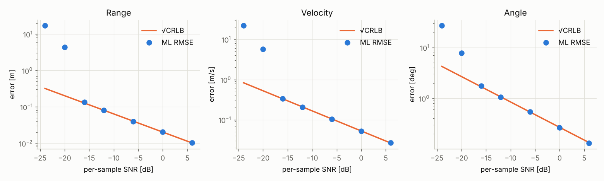
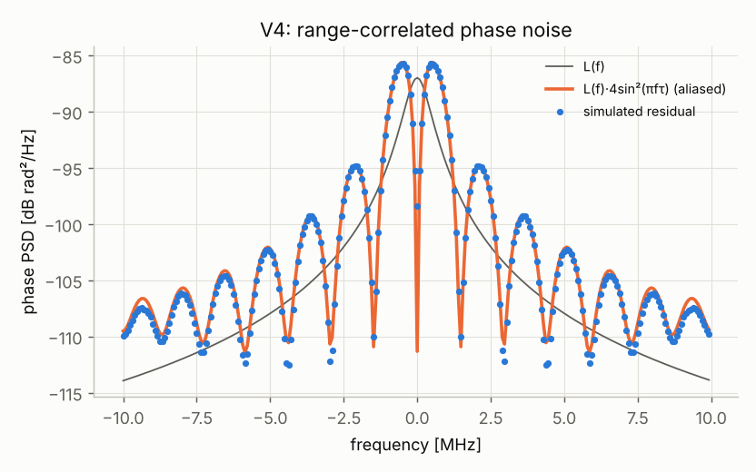
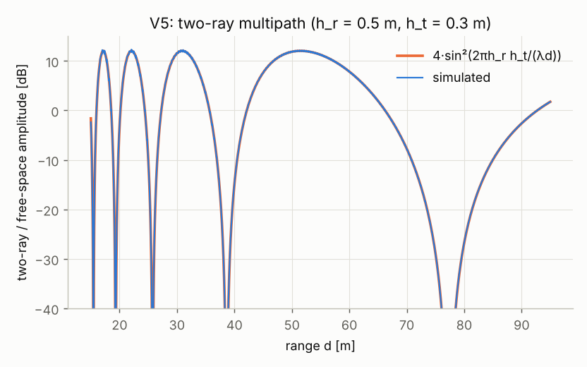
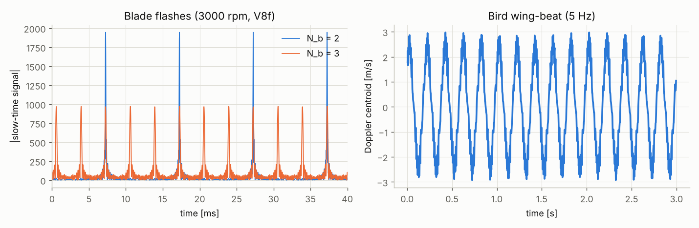

# RadarLab validation report (Python reference)

Mode: full (paper-grade Monte-Carlo sizes). Generated by `python/examples/validation_report.py`; specifications in `docs/literature/fidelity_requirements.md` §15. Convention version 2.

**8 of 8 theory validations and 5 of 5 consistency checks pass.**

## Validation against independent closed-form theory

The simulator and processing output are compared with closed-form results derived independently of the code (detection theory, estimation bounds, phase-noise spectra, propagation geometry, kinematics).

| ID | Check | Criterion | Result | Time |
|---|---|---|---|---|
| V1 | Noise + CFAR false-alarm rate (rect windows) | \|log10(Pfa_sim/Pfa)\| < 0.1 | PASS | 25 s |
| V1c | CFAR Pfa deviation with Hann windows (documented effect) | adjacent-cell correlation = −2/3 (±0.05); Pfa ratio reported | PASS | 3 s |
| V2 | Pd vs SNR (synthesiser, Swerling 0/1/3, K = 1, 8) | theory inside the 99.9 % Wilson CI at every point (Bonferroni-style bound for 30 comparisons; 95 % CI reported) | PASS | 17 s |
| V3 | Estimation: RMSE vs CRLB (range, velocity, angle) | efficiency CRLB/MSE ≥ 0.9 above threshold (≥ 0.8 in quick mode) | PASS | 59 s |
| V4 | Phase noise: range-correlated residual | var within ±2 % (±4 % quick); PSD within ±0.5 dB at fτ = ½ | PASS | 1 s |
| V5 | Two-ray ground multipath | null positions within 0.1 % (λ at the ADC-window centre); amplitude within ±1 dB where 4sin² ≥ 1 | PASS | 1 s |
| V7 | FMCW mutual interference | burst ±1 sample; ghost ±1 range bin | PASS | 0 s |
| V8 | Micro-Doppler (rotor extent, bird wing-beat) | f_mD,max ±1 bin; wing-beat ±2 % | PASS | 1 s |

## Implementation consistency checks

Here the reference is produced by the same model or code: V6 is an algebraic identity of the IQ model, V8f holds by construction of a strictly periodic rotor, V9 uses the same t·Tc timing in the synthesiser and the compensator, V10 compares stored golden files with a fresh export by the same code, and V11 uses a DCA1000 writer and reader built on the same byte-layout assumption. These checks catch regressions and wiring errors, but they cannot detect a shared modelling error.

| ID | Check | Criterion | Result | Time |
|---|---|---|---|---|
| V6 | IQ imbalance image | image level = −IMRR ± 0.5 dB | PASS | 0 s |
| V8f | Blade-flash rate (rotor model self-consistency) | flash rate ±1 % | PASS | 0 s |
| V9 | TDM-MIMO Doppler phase compensation | bias < 0.1 angle bin (Na = 64) | PASS | 0 s |
| V10 | Cross-language golden vectors (Python side) | stored == regenerated (rel ≤ 1e-9); TS checks max\|Δ\| < 1e-9 of peak | PASS | 6 s |
| V11 | DCA1000 closed loop (.cfg → sim → int16 .bin → read → process) | exact round trip; same strong detections; range error < ΔR/4 | PASS | 0 s |

V10 checks the Python side only (stored golden files equal a fresh export). The TypeScript side is checked by the web test suite against the same files. For V11, public raw captures were not available in the sandbox. The closed loop .cfg → sim → int16 .bin → read → process is checked instead.

## V1: Noise + CFAR false-alarm rate (rect windows)

Type: theory validation. Criterion: |log10(Pfa_sim/Pfa)| < 0.1. Result: **PASS**.

| K | detector | pfa_design | pfa_sim | log10_ratio | cells |
|---|---|---|---|---|---|
| 1 | fixed | 0.0001 | 9.712e-05 | -0.01267 | 3006464 |
| 1 | ca | 0.0001 | 0.0001038 | 0.0161 | 3006464 |
| 1 | os | 0.0001 | 9.712e-05 | -0.01267 | 3006464 |
| 1 | go | 0.0001 | 0.0001008 | 0.003387 | 3006464 |
| 1 | so | 0.0001 | 0.0001034 | 0.0147 | 3006464 |
| 4 | fixed | 0.0001 | 0.0001044 | 0.01887 | 3006464 |
| 4 | ca | 0.0001 | 0.0001058 | 0.02437 | 3006464 |
| 4 | os | 0.0001 | 0.0001034 | 0.0147 | 3006464 |
| 4 | go | 0.0001 | 0.0001068 | 0.02845 | 3006464 |
| 4 | so | 0.0001 | 0.0001024 | 0.01049 | 3006464 |
| 8 | fixed | 0.0001 | 9.712e-05 | -0.01267 | 3006464 |
| 8 | ca | 0.0001 | 9.779e-05 | -0.009709 | 3006464 |
| 8 | os | 0.0001 | 9.513e-05 | -0.02169 | 3006464 |
| 8 | go | 0.0001 | 9.679e-05 | -0.01416 | 3006464 |
| 8 | so | 0.0001 | 9.779e-05 | -0.009709 | 3006464 |

## V1c: CFAR Pfa deviation with Hann windows (documented effect)

Type: theory validation. Criterion: adjacent-cell correlation = −2/3 (±0.05); Pfa ratio reported. Result: **PASS**.

| window | detector | pfa_design | pfa_sim | ratio | adjacent_corr |
|---|---|---|---|---|---|
| rect | ca | 0.001 | 0.001014 | 1.014 | 0.007131 |
| rect | os | 0.001 | 0.00103 | 1.03 | 0.007131 |
| hann | ca | 0.001 | 0.001611 | 1.611 | -0.6725 |
| hann | os | 0.001 | 0.001572 | 1.572 | -0.6725 |

## V2: Pd vs SNR (synthesiser, Swerling 0/1/3, K = 1, 8)

Type: theory validation. Criterion: theory inside the 99.9 % Wilson CI at every point (Bonferroni-style bound for 30 comparisons; 95 % CI reported). Result: **PASS**.

29/30 points inside the 95 % CI

| K | swerling | snr_db | pd_sim | pd_theory | ci95 | in_ci95 | trials |
|---|---|---|---|---|---|---|---|
| 1 | 0 | 0 | 0.003333 | 0.003681 | [0.001812, 0.006125] | True | 3000 |
| 1 | 0 | 4 | 0.02433 | 0.02941 | [0.0194, 0.03049] | True | 3000 |
| 1 | 0 | 8 | 0.2633 | 0.2708 | [0.2479, 0.2794] | True | 3000 |
| 1 | 0 | 12 | 0.9277 | 0.9251 | [0.9178, 0.9364] | True | 3000 |
| 1 | 0 | 16 | 1 | 1 | [0.9987, 1] | True | 3000 |
| 1 | 1 | 0 | 0.01033 | 0.01 | [0.007289, 0.01463] | True | 3000 |
| 1 | 1 | 4 | 0.07867 | 0.07261 | [0.06956, 0.08885] | True | 3000 |
| 1 | 1 | 8 | 0.2823 | 0.2836 | [0.2665, 0.2987] | True | 3000 |
| 1 | 1 | 12 | 0.5903 | 0.5789 | [0.5726, 0.6078] | True | 3000 |
| 1 | 1 | 16 | 0.8003 | 0.798 | [0.7856, 0.8143] | True | 3000 |
| 1 | 3 | 0 | 0.008333 | 0.006564 | [0.005651, 0.01227] | True | 3000 |
| 1 | 3 | 4 | 0.056 | 0.05519 | [0.04833, 0.06481] | True | 3000 |
| 1 | 3 | 8 | 0.292 | 0.2924 | [0.276, 0.3085] | True | 3000 |
| 1 | 3 | 12 | 0.683 | 0.6828 | [0.6661, 0.6994] | True | 3000 |
| 1 | 3 | 16 | 0.9087 | 0.9137 | [0.8978, 0.9185] | True | 3000 |
| 8 | 0 | 0 | 0.08167 | 0.08736 | [0.07239, 0.09201] | True | 3000 |
| 8 | 0 | 4 | 0.7613 | 0.7609 | [0.7458, 0.7762] | True | 3000 |
| 8 | 0 | 8 | 1 | 1 | [0.9987, 1] | True | 3000 |
| 8 | 0 | 12 | 1 | 1 | [0.9987, 1] | True | 3000 |
| 8 | 0 | 16 | 1 | 1 | [0.9987, 1] | True | 3000 |
| 8 | 1 | 0 | 0.1823 | 0.1778 | [0.1689, 0.1966] | True | 3000 |
| 8 | 1 | 4 | 0.4643 | 0.473 | [0.4465, 0.4822] | True | 3000 |
| 8 | 1 | 8 | 0.7263 | 0.7344 | [0.7101, 0.742] | True | 3000 |
| 8 | 1 | 12 | 0.8757 | 0.8828 | [0.8634, 0.887] | True | 3000 |
| 8 | 1 | 16 | 0.953 | 0.9513 | [0.9448, 0.96] | True | 3000 |
| 8 | 3 | 0 | 0.1423 | 0.1581 | [0.1303, 0.1553] | False | 3000 |
| 8 | 3 | 4 | 0.5513 | 0.5486 | [0.5335, 0.5691] | True | 3000 |
| 8 | 3 | 8 | 0.8627 | 0.8617 | [0.8499, 0.8745] | True | 3000 |
| 8 | 3 | 12 | 0.9653 | 0.9704 | [0.9582, 0.9713] | True | 3000 |
| 8 | 3 | 16 | 0.9933 | 0.9947 | [0.9897, 0.9957] | True | 3000 |

## V3: Estimation: RMSE vs CRLB (range, velocity, angle)

Type: theory validation. Criterion: efficiency CRLB/MSE ≥ 0.9 above threshold (≥ 0.8 in quick mode). Result: **PASS**.

| snr_db | param | rmse | sqrt_crlb | efficiency | above_threshold |
|---|---|---|---|---|---|
| -24 | range | 16.98 | 0.3199 | 0.000355 | False |
| -24 | velocity | 21.83 | 0.8322 | 0.001453 | False |
| -24 | angle | 0.4686 | 0.07399 | 0.02493 | False |
| -20 | range | 4.381 | 0.2019 | 0.002123 | False |
| -20 | velocity | 5.713 | 0.5251 | 0.008448 | False |
| -20 | angle | 0.1371 | 0.0467 | 0.116 | False |
| -16 | range | 0.1333 | 0.1274 | 0.9128 | False |
| -16 | velocity | 0.3347 | 0.3313 | 0.98 | False |
| -16 | angle | 0.03072 | 0.02946 | 0.9196 | False |
| -12 | range | 0.08159 | 0.08036 | 0.9701 | True |
| -12 | velocity | 0.2076 | 0.209 | 1.014 | True |
| -12 | angle | 0.01845 | 0.01861 | 1.017 | True |
| -6 | range | 0.04004 | 0.04028 | 1.012 | True |
| -6 | velocity | 0.1028 | 0.1048 | 1.039 | True |
| -6 | angle | 0.009395 | 0.009316 | 0.9833 | True |
| 0 | range | 0.02045 | 0.02019 | 0.9743 | True |
| 0 | velocity | 0.05183 | 0.05251 | 1.026 | True |
| 0 | angle | 0.004647 | 0.004672 | 1.011 | True |
| 6 | range | 0.01034 | 0.01012 | 0.9575 | True |
| 6 | velocity | 0.02692 | 0.02632 | 0.9557 | True |
| 6 | angle | 0.002296 | 0.002343 | 1.041 | True |

## V4: Phase noise: range-correlated residual

Type: theory validation. Criterion: var within ±2 % (±4 % quick); PSD within ±0.5 dB at fτ = ½. Result: **PASS**.

| tau_us | var_sim | var_theory | var_rel_err | psd_dev_db_at_ftau_half | skirt_gain_at_ftau_half_db |
|---|---|---|---|---|---|
| 0.68 | 0.004708 | 0.004753 | -0.009544 | -0.02509 | 6.021 |

## V5: Two-ray ground multipath

Type: theory validation. Criterion: null positions within 0.1 % (λ at the ADC-window centre); amplitude within ±1 dB where 4sin² ≥ 1. Result: **PASS**.

Amplitude where 4sin² ≥ 1: max |deviation| 0.59 dB, rms 0.11 dB. Over the whole sweep (floor 1e-3, dominated by the nulls) the rms is 0.46 dB. With λ at the chirp start frequency fc the nulls would be predicted 0.27 % too close (column error_fc_start_m).

| null_theory_m | null_sim_m | error_m | rel_err | error_fc_start_m | range_bin_m |
|---|---|---|---|---|---|
| 77.26 | 77.25 | -0.01359 | -0.0001759 | -0.2213 | 0.3904 |
| 38.63 | 38.62 | -0.006338 | -0.0001641 | -0.1102 | 0.3904 |
| 25.75 | 25.75 | -0.006995 | -0.0002716 | -0.07623 | 0.3904 |
| 19.32 | 19.31 | -0.01001 | -0.0005183 | -0.06194 | 0.3904 |
| 15.45 | 15.44 | -0.009865 | -0.0006384 | -0.05141 | 0.3904 |

## V6: IQ imbalance image

Type: consistency check. Criterion: image level = −IMRR ± 0.5 dB. Result: **PASS**.

Consistency check: the model is y = μx + νx*, so image/signal = |ν|²/|μ|² holds by algebra; this verifies the implementation, not the physics.

| imrr_theory_db | image_sim_dbc | error_db |
|---|---|---|
| 28.93 | -28.93 | 1.217e-11 |

## V7: FMCW mutual interference

Type: theory validation. Criterion: burst ±1 sample; ghost ±1 range bin. Result: **PASS**.

| case | burst_samples_sim | burst_samples_theory | ghost_range_sim_m | ghost_range_theory_m | range_bin_m |
|---|---|---|---|---|---|
| crossing ramps | [6, 6, 6, 6] | 6 |  |  |  |
| equal slopes (ghost) |  |  | 9.076 | 8.994 | 0.2928 |

## V8: Micro-Doppler (rotor extent, bird wing-beat)

Type: theory validation. Criterion: f_mD,max ±1 bin; wing-beat ±2 %. Result: **PASS**.

| check | f_max_theory_hz | f_pos_sim_hz | f_neg_sim_hz | bin_hz | f_w_theory_hz | f_w_sim_hz | rel_err |
|---|---|---|---|---|---|---|---|
| max micro-Doppler | 1.207e+04 | 1.211e+04 | -1.211e+04 | 390.6 |  |  |  |
| bird wing-beat |  |  |  |  | 5 | 5.003 | 0.0006713 |

## V8f: Blade-flash rate (rotor model self-consistency)

Type: consistency check. Criterion: flash rate ±1 %. Result: **PASS**.

| check | rate_theory_hz | rate_sim_hz | rel_err | n_flashes |
|---|---|---|---|---|
| flash rate N_b=2 | 100 | 100 | -1.11e-16 | 30 |
| flash rate N_b=3 | 300 | 300 | -3.992e-06 | 92 |

## V9: TDM-MIMO Doppler phase compensation

Type: consistency check. Criterion: bias < 0.1 angle bin (Na = 64). Result: **PASS**.

Consistency check: synthesiser and compensator use the same t·Tc timing, so a shared timing error would not be detected. An independent bistatic first-principles synthesiser (review round 1) confirmed the physics.

| theta_deg | v_over_vmax | bias_uncomp_bins | bias_comp_bins |
|---|---|---|---|
| -30 | 0.8 | -2.443 | 0.0007669 |
| 0 | 0.8 | -2.443 | 0.0007669 |
| 20 | 0.8 | -2.441 | 0.0004771 |

## V10: Cross-language golden vectors (Python side)

Type: consistency check. Criterion: stored == regenerated (rel ≤ 1e-9); TS checks max|Δ| < 1e-9 of peak. Result: **PASS**.

| file | max_rel_dev | goldenSet | conventionVersion | ok |
|---|---|---|---|---|
| tiny_cube | 0 | 2 | 2 | True |
| automotive_single | 0 | 2 | 2 | True |
| automotive_multi | 0 | 2 | 2 | True |
| automotive_velocity_alias | 0 | 2 | 2 | True |
| awr1843_elevated | 0 | 2 | 2 | True |
| cfar_alpha | 0 | 2 | 2 | True |
| presets | 0 | 2 | 2 | True |
| tiny_mti | 0 | 2 | 2 | True |
| tiny_real_iq | 0 | 2 | 2 | True |
| tiny_physical | 0 | 2 | 2 | True |
| cfar_maps | 0 | 2 | 2 | True |
| clustering | 0 | 2 | 2 | True |
| tracker | 0 | 2 | 2 | True |

## V11: DCA1000 closed loop (.cfg → sim → int16 .bin → read → process)

Type: consistency check. Criterion: exact round trip; same strong detections; range error < ΔR/4. Result: **PASS**.

Consistency check: writer and reader follow the same byte-layout assumption and no real capture is used; a check against TI's readDCA1000.m or a public capture is still open.

| exact_roundtrip | same_detections | n_detections | max_range_err_m | range_bin_m |
|---|---|---|---|---|
| True | True | 2 | 0.006749 | 0.1952 |

